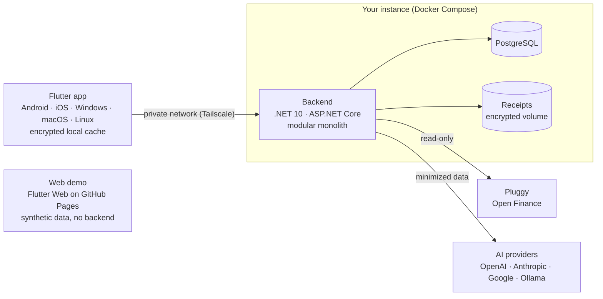

# GranaPaCá

**All your bank accounts in one place, on your own machine.**

Open source, self-hosted personal finance app for Brazil: Open Finance through Pluggy, rule-based and AI categorization, and privacy first.

[Português](README.md) · [Architecture](#architecture) · [Roadmap](#roadmap) · [Security](SECURITY.md) · [Contributing](CONTRIBUTING.md)

> [!NOTE]
> **In planning.** There is no usable release yet. This repository holds the documentation and architecture decisions while Phase 0 (foundation) starts.

## What it is

GranaPaCá brings accounts from several Brazilian banks together through Open Finance: balances, statements, credit cards and bills, with the full history of spending and income. Rules and AI categorize every transaction, and a chat answers questions about your own finances, always showing the numbers and the period it used.

Each person runs their own instance (self-hosted, single-tenant) with their own Pluggy and AI provider credentials. There is no central server: whoever maintains the project has no access to anyone's data.

## Principles

- **Privacy first.** Data stays in your instance, secrets never reach the app, and nothing goes to an AI provider without minimization.
- **Read-only.** The app never initiates payments or moves money.
- **AI as an assistant, not a decision-maker.** Every classification comes with an explanation and can be corrected; rules suggested by AI only apply after you confirm them.
- **Non-judgmental labels.** Three levels of essentiality: Essential, Important and Flexible.
- **Bank data preserved.** Corrections live in their own layer, with history, and the daily sync never erases a correction.
- **Secure by default.** There are no default credentials, and the system refuses to start without a master key and a strong password.

## Planned features

| Area | What it does | When |
|---|---|---|
| Demo mode | Try it in the browser with 100% synthetic data, no bank connection needed | MVP |
| Accounts and banks | Connection through Meu Pluggy, consolidated and per-bank statements, status of each connection | MVP |
| Rule-based categorization | User, profile and system rules, with manual correction, history and undo | MVP |
| Charts | Donut by category and a ranking of the heaviest categories | MVP |
| Onboarding guide | Profile by occupation, household and commute that defines what is essential for you | After the MVP |
| Cash | Quick entry of cash expenses, working offline | After the MVP |
| AI | Categorizes what rules can't, plus a chat with read-only tools, using your own OpenAI, Anthropic or Google key, or a local Ollama model | After the MVP |
| Receipts and NFC-e | Photos, PDFs and the invoice QR code, with line items becoming parts of the transaction | After the MVP |
| Planning and alerts | Budgets, goals, projections, forgotten subscriptions and proactive alerts | After the MVP |
| Export and import | CSV, XLSX, PDF, full JSON backup and OFX/CSV import | After the MVP |

## Architecture

Only the backend talks to Pluggy and to AI providers, so secrets never reach the app. By default the API lives on a private network (Tailscale), not exposed to the internet. The web demo runs entirely in the browser, with no backend.

## Reference stack

| Layer | Technology |
|---|---|
| App (mobile, desktop and web demo) | Flutter and Dart 3 |
| Backend | .NET 10 (LTS) and ASP.NET Core, as a modular monolith |
| Data | PostgreSQL, Dapper and DbUp |
| AI | Microsoft.Extensions.AI, with OpenAI, Anthropic, Google and Ollama |
| Banking integration | Pluggy (Meu Pluggy) and OFX/CSV import |
| Infrastructure | Docker Compose (amd64 and arm64), Tailscale and optional Caddy |
| Quality | GitHub Actions, xUnit, Testcontainers and flutter_test |

Every relevant choice is recorded as an ADR in [`docs/adr`](docs/adr) (in Portuguese), and any change to the stack needs a new ADR.

## Roadmap

1. **Phase 0, Foundation:** repository, CI, security baseline and app and backend skeletons.
2. **Phase 1, Browsable demo:** Flutter Web with synthetic data, published on GitHub Pages.
3. **Phase 2, Real data:** Pluggy connection, daily sync and per-bank statements.
4. **Phase 3, MVP:** rule-based categorization, manual correction with history and the first two charts.

After the MVP come the onboarding guide, cash entries, AI, receipts and invoices, planning, alerts and export.

## Running your own instance

There is no installable release yet. When there is, a single `docker compose up` will start the backend and database on your computer or on a VM reached through Tailscale, and the guide will live in [`infra/`](infra/).

Each person creates their own Pluggy account and connects their own banks in Meu Pluggy. That mode is for personal, non-commercial use; check Pluggy's current terms before using it.

## Security and privacy

- Never report a vulnerability in a public issue: use [private reporting](SECURITY.md).
- Never paste statements, screenshots, CPF numbers, account numbers, tokens or keys into issues, PRs or commits. Use synthetic data.
- The repository holds only code and documentation. Credentials live in each instance's `.env`, outside Git.

## Contributing

Documentation and issues are written in Brazilian Portuguese, but issues in English are welcome. Read the [contributing guide](CONTRIBUTING.md) and the [code of conduct](CODE_OF_CONDUCT.md).

## License

[GNU AGPL-3.0](LICENSE). You may use, study, modify and host GranaPaCá. Anyone who offers a modified version as a network service must make that version's source code available to its users.

GranaPaCá is not affiliated with Pluggy or any bank. Names mentioned belong to their respective owners.
