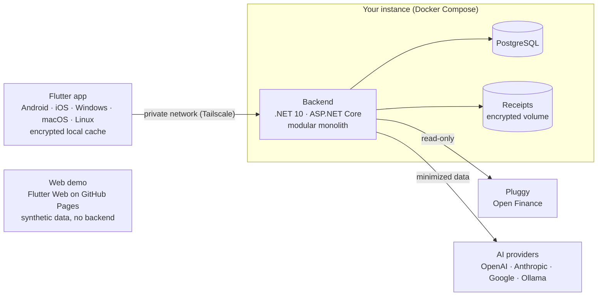

<div align="center">

# GranaPaCá

**All your bank accounts in one place, on your own machine.**

Open source, self-hosted personal finance app for Brazil: Open Finance through Pluggy, rule-based and AI categorization, and privacy first.

[](LICENSE)

[](https://github.com/igorgmassi/granapaca/actions/workflows/secret-scan.yml)

[Português](README.md) · [Web demo](https://igorgmassi.github.io/granapaca/) · [Architecture](#architecture) · [Roadmap](#roadmap) · [Security](SECURITY.md) · [Contributing](CONTRIBUTING.md)

</div>

> [!NOTE]
> **Active development — MVP implemented.** The backend (.NET 10 + PostgreSQL 18), the Docker Compose stack with Tailscale and encrypted backup guides, the YAML onboarding profiles catalog ([`profiles/`](profiles/)), and the Flutter app with a [browsable web demo](https://igorgmassi.github.io/granapaca/) are already working in this repository. Post-MVP features are actively being built.

## What it is

GranaPaCá brings accounts from several Brazilian banks together through Open Finance: balances, statements, credit cards and bills, with the full history of spending and income. Rules and AI categorize every transaction, and a chat answers questions about your own finances, always showing the numbers and the period it used.

Each person runs their own instance (self-hosted, single-tenant) with their own Pluggy and AI provider credentials. There is no central server: whoever maintains the project has no access to anyone's data.

## Principles

- **Privacy first.** Data stays in your instance, secrets never reach the app, and nothing goes to an AI provider without minimization.
- **Read-only.** The app never initiates payments or moves money.
- **AI as an assistant, not a decision-maker.** Every classification comes with an explanation and can be corrected; rules suggested by AI only apply after you confirm them.
- **Non-judgmental labels.** Three levels of essentiality: Essential, Important and Flexible.
- **Bank data preserved.** Corrections live in their own layer, with history, and the daily sync never erases a correction.
- **Secure by default.** There are no default credentials, and the system refuses to start without a master key and a strong password.

## Features

| Area | What it does | Status |
|---|---|---|
| Demo mode | Try it in the browser ([GitHub Pages demo](https://igorgmassi.github.io/granapaca/)) or in the app with 100% synthetic data, no bank connection needed | Available (MVP) |
| Accounts and banks | Connection through Meu Pluggy, automatic synthetic mode, consolidated and per-bank statements, cards/bills and daily sync | Available (MVP) |
| Rule-based categorization | Layered deterministic engine (manual corrections, user rules, profile rules and system rules), review queue, history and undo | Available (MVP) |
| Charts | Donut by category, ranking of the heaviest categories and essentiality breakdown | Available (MVP) |
| Onboarding guide | YAML catalog ([`profiles/`](profiles/)) by occupation, household and commute generating explained essentiality rules | Available |
| Security and operations | TOTP 2FA, opaque tokens with rotating refresh, envelope field encryption, encrypted offline cache, in-app alerts inbox and encrypted `restic` backups | Available |
| Import and export | OFX/CSV file import (available); CSV, XLSX, PDF export and full JSON backup | Partial (post-MVP) |
| Cash | Quick entry of cash expenses, working offline | Post-MVP |
| AI | Categorizes what rules can't, plus a chat with read-only tools (OpenAI, Anthropic, Google or local Ollama), always with minimization and pseudonymization | Post-MVP |
| Receipts and NFC-e | Per-file encrypted local volume storage, deterministic NFC-e XML/QR parser (ES first) and optional AI vision fallback | Post-MVP |
| Planning and alerts | Budgets, goals, projections, forgotten subscriptions and optional push notifications via `ntfy` | Post-MVP |

## Architecture



Only the backend talks to Pluggy and to AI providers, so secrets never reach the app. By default the API lives on a private network (Tailscale), not exposed to the internet. The web demo runs entirely in the browser, with no backend.

## Reference stack

| Layer | Technology |
|---|---|
| App (mobile, desktop and web demo) | Flutter and Dart 3 |
| Backend | .NET 10 (LTS) and ASP.NET Core, as a modular monolith |
| Data | PostgreSQL 18, Dapper and DbUp |
| AI | Typed HTTP clients (open path to Microsoft.Extensions.AI), with OpenAI, Anthropic, Google and Ollama |
| Banking integration | Pluggy (Meu Pluggy) and OFX/CSV import |
| Infrastructure | Docker Compose (amd64 and arm64), Tailscale, optional Caddy and restic backups |
| Quality | GitHub Actions, xUnit, Testcontainers, ArchUnitNET and flutter_test |

All 29 architecture decisions are recorded as ADRs in [`docs/adr`](docs/adr) (in Portuguese), and any change to the stack needs a new ADR.

## Roadmap

1. **Phase 0, Foundation (completed):** repository, CI, security baseline, multi-arch Docker Compose and app and backend skeletons.
2. **Phase 1, Browsable demo (completed):** Flutter Web with synthetic data, published on GitHub Pages.
3. **Phase 2, Real data (completed):** Pluggy connection (plus synthetic mode), daily sync, OFX/CSV import and per-bank statements.
4. **Phase 3, MVP (completed):** rule-based categorization and YAML profiles, manual correction with history, review queue, alerts inbox, TOTP 2FA, encrypted offline cache and charts.

After the MVP come cash entries, AI with minimization and pseudonymization, receipts and NFC-e invoices, planning (budgets, goals and projections), push via `ntfy` and full export.

## Running your own instance

All you need is Docker with Compose v2, on `amd64` or `arm64`:

```bash
cd infra
./init-secrets.sh
cp .env.example .env
docker compose up --build --detach --wait
```

Verify that the API and database came up healthy:

```bash
curl http://127.0.0.1:8080/health
curl http://127.0.0.1:8080/api/v1/server-info
```

If `PLUGGY_CLIENT_ID` and `PLUGGY_CLIENT_SECRET` are left blank in `infra/.env`, the instance automatically starts in **Synthetic** mode (`"providerMode": "synthetic"`), so you can try the full flow without connecting real bank accounts. By default, the API binds only to `127.0.0.1:8080` and exposes no ports to the internet.

- **Full instance guide:** [`infra/README.md`](infra/README.md) (in Portuguese)
- **Private remote access (Tailscale) and optional Caddy:** [`infra/TAILSCALE.md`](infra/TAILSCALE.md)
- **Encrypted daily backups with `restic` and restore runbook:** [`infra/BACKUP.md`](infra/BACKUP.md)
- **YAML onboarding profiles catalog:** [`profiles/README.md`](profiles/README.md)
- **Try without installing anything:** [web demo on GitHub Pages](https://igorgmassi.github.io/granapaca/) (100% synthetic data, right in the browser)

Each person creates their own Pluggy account and connects their own banks in Meu Pluggy. That mode is for personal, non-commercial use; check Pluggy's current terms before using it.

## Security and privacy

- Never report a vulnerability in a public issue: use [private reporting](SECURITY.md).
- Never paste statements, screenshots, CPF numbers, account numbers, tokens or keys into issues, PRs or commits. Use synthetic data.
- The repository holds only code and documentation. Credentials live in each instance's `.env`, outside Git.

## Contributing

Documentation and issues are written in Brazilian Portuguese, but issues in English are welcome. Read the [contributing guide](CONTRIBUTING.md) and the [code of conduct](CODE_OF_CONDUCT.md).

## License

[GNU AGPL-3.0](LICENSE). You may use, study, modify and host GranaPaCá. Anyone who offers a modified version as a network service must make that version's source code available to its users.

GranaPaCá is not affiliated with Pluggy or any bank. Names mentioned belong to their respective owners.
