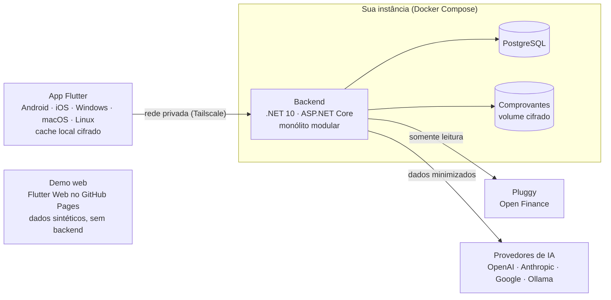

<div align="center">

# GranaPaCá

**Todas as suas contas num só lugar, na sua própria máquina.**

App de finanças pessoais open source e self-hosted: Open Finance via Pluggy, categorização por regras e IA, e privacidade em primeiro lugar.

[](LICENSE)

[](https://github.com/igorgmassi/granapaca/actions/workflows/secret-scan.yml)

[English](README.en.md) · [Demo web](https://igorgmassi.github.io/granapaca/) · [Arquitetura](#arquitetura) · [Roadmap](#roadmap) · [Segurança](SECURITY.md) · [Contribuir](CONTRIBUTING.md)

</div>

> [!NOTE]
> **Em desenvolvimento ativo — MVP implementado.** O backend (.NET 10 + PostgreSQL 18), a pilha Docker Compose com guias de Tailscale e backup cifrado, o catálogo de perfis em YAML ([`profiles/`](profiles/)) e o app Flutter com [demo web navegável](https://igorgmassi.github.io/granapaca/) já funcionam no repositório. Os recursos pós-MVP seguem em construção.

## O que é

O GranaPaCá reúne as contas de vários bancos num só lugar, via Open Finance: saldo, extrato, cartões e faturas, com o histórico completo de gastos e ganhos. Regras e IA categorizam cada transação, e um chat responde perguntas sobre as suas finanças mostrando os números e o período usados.

Cada pessoa roda a própria instância (self-hosted, single-tenant), com as próprias credenciais da Pluggy e dos provedores de IA. Não existe servidor central: quem mantém o projeto não tem acesso aos dados de ninguém.

## Princípios

- **Privacidade primeiro.** Os dados ficam na sua instância, segredos nunca chegam ao app e nada vai para a IA sem minimização.
- **Somente leitura.** O app nunca inicia pagamentos nem movimenta dinheiro.
- **IA como assistente, não como decisora.** Toda classificação vem com explicação e pode ser corrigida; regras sugeridas pela IA só valem depois de confirmadas.
- **Rótulos sem julgamento.** Essencialidade em três níveis: Essencial, Importante e Flexível.
- **Dado do banco preservado.** Correções ficam numa camada própria, com histórico, e a sincronização diária nunca apaga uma correção.
- **Seguro por padrão.** Não existe credencial padrão, e o sistema não sobe sem chave mestra e senha forte.

## Funcionalidades

| Área | O que faz | Status |
|---|---|---|
| Modo demo | Testar no navegador ([demo no GitHub Pages](https://igorgmassi.github.io/granapaca/)) ou no app com dados 100% sintéticos, sem conectar banco | Disponível (MVP) |
| Contas e bancos | Conexão via Meu Pluggy, modo sintético automático, extrato consolidado e por banco, cartões/faturas e sincronização diária | Disponível (MVP) |
| Categorização por regras | Motor determinístico em camadas (correções manuais, regras do usuário, perfil e sistema), fila "A revisar", histórico e desfazer | Disponível (MVP) |
| Gráficos | Rosca por categoria, ranking das categorias que mais pesam e divisão por essencialidade | Disponível (MVP) |
| Guia inicial | Catálogo em YAML ([`profiles/`](profiles/)) por ocupação, casa e transporte que gera regras explicadas de essencialidade | Disponível |
| Segurança e operação | 2FA TOTP, tokens opacos com refresh rotativo, criptografia de campo em envelope, cache offline cifrado, alertas na caixa de entrada e backup cifrado com `restic` | Disponível |
| Importação e exportação | Importação de arquivos OFX/CSV (disponível); exportação em CSV, XLSX, PDF e backup completo em JSON | Parcial (pós-MVP) |
| Dinheiro físico | Lançamento rápido de gastos em espécie, funcionando offline | Pós-MVP |
| IA | Categorização do que as regras não resolvem e chat com ferramentas somente leitura (OpenAI, Anthropic, Google ou Ollama local), sempre com minimização e pseudonimização | Pós-MVP |
| Comprovantes e NFC-e | Armazenamento cifrado por arquivo no volume local, parser determinístico de XML/QR NFC-e (ES primeiro) e fallback opcional de visão por IA | Pós-MVP |
| Planejamento e alertas | Orçamentos, metas, projeções, assinaturas esquecidas e notificações push opcionais via `ntfy` | Pós-MVP |

## Arquitetura



Só o backend fala com a Pluggy e com os provedores de IA, então segredos nunca chegam ao app. Por padrão, a API fica numa rede privada (Tailscale), sem exposição na internet. A demo web roda sozinha no navegador, sem backend.

## Stack de referência

| Camada | Tecnologia |
|---|---|
| App (mobile, desktop e demo web) | Flutter e Dart 3 |
| Backend | .NET 10 (LTS) e ASP.NET Core, como monólito modular |
| Dados | PostgreSQL 18, Dapper e DbUp |
| IA | Clientes HTTP tipados (caminho aberto para Microsoft.Extensions.AI), com OpenAI, Anthropic, Google e Ollama |
| Integração bancária | Pluggy (Meu Pluggy) e importação de OFX/CSV |
| Infraestrutura | Docker Compose (amd64 e arm64), Tailscale, Caddy opcional e backup com restic |
| Qualidade | GitHub Actions, xUnit, Testcontainers, ArchUnitNET e flutter_test |

Todas as 29 decisões de arquitetura estão registradas em [`docs/adr`](docs/adr), e qualquer troca na stack passa por um ADR novo.

## Estrutura do repositório

```text
granapaca/
├── app/        # app Flutter (mobile, desktop e demo web)
├── backend/    # API e jobs em ASP.NET Core
├── profiles/   # perfis do guia inicial, em YAML
├── infra/      # Docker Compose, Caddy e guias de instalação
└── docs/       # ADRs e documentação
```

## Roadmap

1. **Fase 0, Fundação (concluída):** repositório, CI, base de segurança, Docker Compose multi-arch e esqueletos do app e do backend.
2. **Fase 1, Demo navegável (concluída):** Flutter Web com dados sintéticos, publicado no GitHub Pages.
3. **Fase 2, Dados reais (concluída):** conexão com a Pluggy (e modo sintético), sincronização diária, importação OFX/CSV e extrato por banco.
4. **Fase 3, MVP (concluída):** categorização por regras e perfis em YAML, correção manual com histórico, fila "A revisar", alertas na caixa de entrada, 2FA TOTP, cache offline cifrado e gráficos.

Depois do MVP entram dinheiro físico, IA com minimização e pseudonimização, comprovantes e NFC-e, planejamento (orçamentos, metas e projeções), push via `ntfy` e exportação completa.

## Rodando a sua instância

Você precisa só do Docker com Compose v2, em `amd64` ou `arm64`:

```bash
cd infra
./init-secrets.sh
cp .env.example .env
docker compose up --build --detach --wait
```

Confira se a API e o banco subiram saudáveis:

```bash
curl http://127.0.0.1:8080/health
curl http://127.0.0.1:8080/api/v1/server-info
```

Se `PLUGGY_CLIENT_ID` e `PLUGGY_CLIENT_SECRET` ficarem vazios no `infra/.env`, a instância sobe automaticamente em modo **Sintético** (`"providerMode": "synthetic"`), útil para testar tudo sem conectar bancos reais. Por padrão, a API escuta apenas em `127.0.0.1:8080`, sem expor portas na internet.

- **Guia completo da instância:** [`infra/README.md`](infra/README.md)
- **Acesso remoto privado (Tailscale) e Caddy opcional:** [`infra/TAILSCALE.md`](infra/TAILSCALE.md)
- **Backup diário cifrado com `restic` e restauração:** [`infra/BACKUP.md`](infra/BACKUP.md)
- **Catálogo de perfis em YAML:** [`profiles/README.md`](profiles/README.md)
- **Testar sem instalar nada:** [demo web no GitHub Pages](https://igorgmassi.github.io/granapaca/) (dados 100% sintéticos, direto no navegador)

Cada pessoa cria a própria conta na Pluggy e conecta os próprios bancos no Meu Pluggy. Esse modo é para uso pessoal e não comercial; confira os termos atuais da Pluggy antes de usar.

## Segurança e privacidade

- Vulnerabilidade nunca vai em issue pública: use o [relato privado](SECURITY.md).
- Nunca cole extratos, prints, CPF, números de conta, tokens ou chaves em issues, PRs ou commits. Use dados sintéticos.
- O repositório contém só código e documentação. Credenciais ficam no `.env` de cada instância, fora do Git.

## Contribuindo

Contribuições são bem-vindas, inclusive perfis novos para o guia inicial. Leia o [guia de contribuição](CONTRIBUTING.md) e o [código de conduta](CODE_OF_CONDUCT.md).

## Licença

[GNU AGPL-3.0](LICENSE). Você pode usar, estudar, modificar e hospedar o GranaPaCá. Quem oferecer uma versão modificada como serviço em rede precisa disponibilizar o código-fonte dessa versão a quem a usa.

O GranaPaCá não é afiliado à Pluggy nem a nenhum banco. Os nomes citados pertencem aos respectivos donos.
