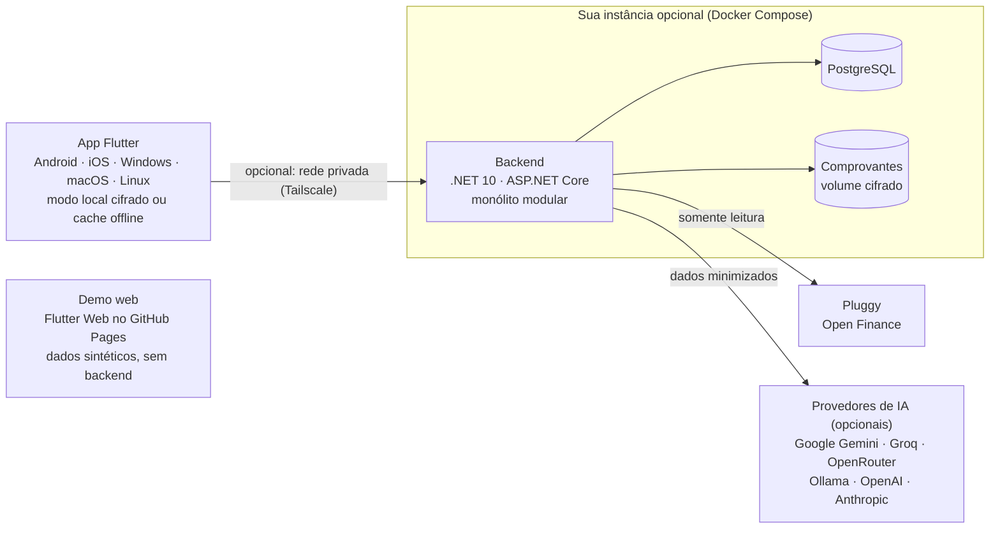

<div align="center">

# GranaPaCá

**Todas as suas contas num só lugar, no seu aparelho ou na sua própria máquina.**

App de finanças pessoais open source, local-first e self-hosted: comece só no celular ou computador sem servidor, ou suba a sua instância com Open Finance via Pluggy e IA opcional gratuita.

[](LICENSE)

[](https://github.com/igorgmassi/granapaca/actions/workflows/secret-scan.yml)

[English](README.en.md) · [Demo web](https://igorgmassi.github.io/granapaca/) · [Como usar](#como-usar-do-mais-simples-ao-self-hosted) · [Arquitetura](#arquitetura) · [Roadmap](#roadmap) · [Segurança](SECURITY.md) · [Contribuir](CONTRIBUTING.md)

</div>

> [!NOTE]
> **Em desenvolvimento ativo — MVP implementado.** O backend (.NET 10 + PostgreSQL 18), a pilha Docker Compose com guias de Tailscale e backup cifrado, o catálogo de perfis em YAML ([`profiles/`](profiles/)) e o app Flutter com [demo web navegável](https://igorgmassi.github.io/granapaca/) já funcionam no repositório. Os recursos pós-MVP seguem em construção.

## O que é

O GranaPaCá reúne suas finanças pessoais num só lugar — saldo, extrato, cartões, faturas, orçamentos e metas — sem servidor central e sem coletar seus dados. Regras determinísticas e a assistente **Paçoca** categorizam cada transação e respondem perguntas sobre o seu dinheiro mostrando os números e o período usados.

Você pode começar **direto no próprio aparelho, sem instalar Docker nem banco de dados**, ou rodar a **própria instância (self-hosted, single-tenant)** com as próprias credenciais da Pluggy e provedores de IA opcionais. Não existe servidor central: quem mantém o projeto não tem acesso aos dados de ninguém.

## Como usar (do mais simples ao self-hosted)

Comece do jeito mais simples hoje e evolua quando quiser, sem perder seu histórico ([ADR-030](docs/adr/0030-modo-local-no-aparelho-e-ia-gratuita.md)):

1. **Só neste aparelho (sem servidor):** abra o app, guarde tudo cifrado no próprio celular ou computador, proteja com PIN/biometria, importe extratos OFX/CSV ou notas NFC-e, lance gastos na hora e faça backup/restauração em JSON com 1 toque — **zero Docker, zero PostgreSQL e nenhuma conta de IA paga**.
2. **Explorar a demo:** teste o app completo direto no navegador ([demo web no GitHub Pages](https://igorgmassi.github.io/granapaca/)) sem instalar nada, com dados 100% sintéticos.
3. **Instância própria (Docker Compose):** para sincronização automática diária via Open Finance (Pluggy), vários aparelhos sincronizados e backup diário cifrado fora da máquina com `restic`. Veja [Rodando a sua instância](#rodando-a-sua-instância).

## Princípios

- **Privacidade primeiro.** Os dados ficam no seu aparelho ou na sua instância, segredos nunca chegam ao app e nada vai para a IA sem minimização.
- **Somente leitura.** O app nunca inicia pagamentos nem movimenta dinheiro.
- **IA como assistente, não como decisora.** Toda classificação vem com explicação e pode ser corrigida; regras sugeridas pela IA só valem depois de confirmadas.
- **Rótulos sem julgamento.** Essencialidade em três níveis: Essencial, Importante e Flexível.
- **Dado do banco preservado.** Correções ficam numa camada própria, com histórico, e a sincronização diária nunca apaga uma correção.
- **Seguro por padrão.** Não existe credencial padrão, e o sistema não sobe sem chave mestra e senha forte.

## Funcionalidades

| Área | O que faz | Status |
|---|---|---|
| Só neste aparelho | Banco local cifrado no celular/computador, bloqueio por PIN/biometria, lançamento rápido, importação OFX/CSV e NFC-e, e backup/restauração JSON em 1 toque — sem servidor | Em evolução ([ADR-030](docs/adr/0030-modo-local-no-aparelho-e-ia-gratuita.md)) |
| Modo demo | Testar no navegador ([demo no GitHub Pages](https://igorgmassi.github.io/granapaca/)) ou no app com dados 100% sintéticos, sem conectar banco | Disponível (MVP) |
| Contas e bancos | Conexão via Meu Pluggy, modo sintético automático, extrato consolidado e por banco, cartões/faturas e sincronização diária | Disponível (MVP) |
| Categorização por regras | Motor determinístico em camadas (correções manuais, regras do usuário, perfil e sistema), fila "A revisar", histórico e desfazer | Disponível (MVP) |
| Gráficos | Rosca por categoria, ranking das categorias que mais pesam e divisão por essencialidade | Disponível (MVP) |
| Guia inicial | Catálogo em YAML ([`profiles/`](profiles/)) por ocupação, casa e transporte que gera regras explicadas de essencialidade | Disponível |
| Segurança e operação | 2FA TOTP, tokens opacos com refresh rotativo, criptografia de campo em envelope, cache offline cifrado, alertas na caixa de entrada e backup cifrado com `restic` | Disponível |
| Importação e exportação | Importação de arquivos OFX/CSV (disponível); exportação em CSV, XLSX, PDF e backup completo em JSON | Parcial (pós-MVP) |
| Dinheiro físico | Lançamento rápido de gastos em espécie, funcionando offline | Pós-MVP |
| Assistente Paçoca e IA | Motor determinístico local grátis e offline por padrão; IA generativa opcional em camadas gratuitas (Google Gemini Flash, Groq, OpenRouter `:free`), Ollama local ou provedores pagos, sempre com minimização e pseudonimização | Pós-MVP |
| Comprovantes e NFC-e | Armazenamento cifrado por arquivo no volume local, parser determinístico de XML/QR NFC-e (ES primeiro) e fallback opcional de visão por IA | Pós-MVP |
| Planejamento e alertas | Orçamentos, metas, projeções, assinaturas esquecidas e notificações push opcionais via `ntfy` | Pós-MVP |

### Assistente Paçoca e IA (nenhuma conta paga é obrigatória)

Você **não precisa de nenhuma conta de IA paga** para usar o GranaPaCá:

- **Grátis e offline por padrão:** a Paçoca funciona sem conta e sem internet usando o motor determinístico local (regras em camadas + perguntas financeiras sobre saldo, categorias, estabelecimentos, orçamentos, metas, regra 50/30/20, projeções e assinaturas), tanto no aparelho quanto no backend (`provider = "none"`).
- **IA generativa gratuita ou local (opcional):** se quiser respostas generativas, há presets prontos para **Google Gemini Flash** (camada gratuita via Google AI Studio), **Groq** (camada gratuita compatível com OpenAI), **OpenRouter** (modelos `:free`) e **Ollama local** (100% gratuito na sua máquina), além de OpenAI e Anthropic.
- **Privacidade preservada em qualquer tier:** toda chamada externa passa obrigatoriamente pela minimização e pseudonimização reversível de PII ([ADR-023](docs/adr/0023-minimizacao-e-pseudonimizacao-ia.md)), removendo CPF, CNPJ, contas, telefones e e-mails, com aviso transparente sobre as políticas de retenção de planos gratuitos antes de ativar a chave.

## Arquitetura



No modo **Só neste aparelho**, o app guarda tudo cifrado localmente e roda a Paçoca determinística offline, sem precisar de servidor. Na **instância própria**, só o backend fala com a Pluggy e com os provedores de IA opcionais, então segredos nunca chegam ao app e a API fica numa rede privada (Tailscale) por padrão. A **demo web** roda sozinha no navegador, sem backend.

## Stack de referência

| Camada | Tecnologia |
|---|---|
| App (mobile, desktop e demo web) | Flutter e Dart 3 (modo local cifrado sem servidor, cache offline e demo web) |
| Backend (instância própria opcional) | .NET 10 (LTS) e ASP.NET Core, como monólito modular |
| Dados | Armazenamento local cifrado no aparelho; PostgreSQL 18, Dapper e DbUp na instância |
| IA | Motor determinístico local gratuito (padrão) + clientes HTTP tipados opcionais (Google Gemini Flash, Groq, OpenRouter, Ollama, OpenAI e Anthropic) |
| Integração bancária | Importação OFX/CSV e NFC-e no aparelho; Pluggy (Meu Pluggy) na instância |
| Infraestrutura | Docker Compose (amd64 e arm64), Tailscale, Caddy opcional e backup com restic |
| Qualidade | GitHub Actions, xUnit, Testcontainers, ArchUnitNET e flutter_test |

Todas as 30 decisões de arquitetura estão registradas em [`docs/adr`](docs/adr), e qualquer troca na stack passa por um ADR novo.

## Estrutura do repositório

```text
granapaca/
├── app/        # app Flutter (mobile, desktop e demo web)
├── backend/    # API e jobs em ASP.NET Core
├── profiles/   # perfis do guia inicial, em YAML
├── infra/      # Docker Compose, Caddy e guias de instalação
└── docs/       # ADRs e documentação
```

## Roadmap

1. **Fase 0, Fundação (concluída):** repositório, CI, base de segurança, Docker Compose multi-arch e esqueletos do app e do backend.
2. **Fase 1, Demo navegável (concluída):** Flutter Web com dados sintéticos, publicado no GitHub Pages.
3. **Fase 2, Dados reais (concluída):** conexão com a Pluggy (e modo sintético), sincronização diária, importação OFX/CSV e extrato por banco.
4. **Fase 3, MVP (concluída):** categorização por regras e perfis em YAML, correção manual com histórico, fila "A revisar", alertas na caixa de entrada, 2FA TOTP, cache offline cifrado e gráficos.

Depois do MVP entram dinheiro físico, IA com minimização e pseudonimização, comprovantes e NFC-e, planejamento (orçamentos, metas e projeções), push via `ntfy` e exportação completa.

## Rodando a sua instância

> [!TIP]
> **Opcional:** você só precisa subir uma instância se quiser sincronização automática com bancos via Open Finance (Pluggy), múltiplos aparelhos sincronizados ou backup `restic` fora da máquina. Para uso individual sem servidor, basta escolher **Só neste aparelho** ao abrir o app.

Você precisa só do Docker com Compose v2, em `amd64` ou `arm64`:

```bash
cd infra
./init-secrets.sh
cp .env.example .env
docker compose up --build --detach --wait
```

Confira se a API e o banco subiram saudáveis:

```bash
curl http://127.0.0.1:8080/health
curl http://127.0.0.1:8080/api/v1/server-info
```

Se `PLUGGY_CLIENT_ID` e `PLUGGY_CLIENT_SECRET` ficarem vazios no `infra/.env`, a instância sobe automaticamente em modo **Sintético** (`"providerMode": "synthetic"`), útil para testar tudo sem conectar bancos reais. Por padrão, a API escuta apenas em `127.0.0.1:8080`, sem expor portas na internet.

- **Guia completo da instância:** [`infra/README.md`](infra/README.md)
- **Acesso remoto privado (Tailscale) e Caddy opcional:** [`infra/TAILSCALE.md`](infra/TAILSCALE.md)
- **Backup diário cifrado com `restic` e restauração:** [`infra/BACKUP.md`](infra/BACKUP.md)
- **Catálogo de perfis em YAML:** [`profiles/README.md`](profiles/README.md)
- **Testar sem instalar nada:** [demo web no GitHub Pages](https://igorgmassi.github.io/granapaca/) (dados 100% sintéticos, direto no navegador)

Cada pessoa cria a própria conta na Pluggy e conecta os próprios bancos no Meu Pluggy. Esse modo é para uso pessoal e não comercial; confira os termos atuais da Pluggy antes de usar.

## Segurança e privacidade

- Vulnerabilidade nunca vai em issue pública: use o [relato privado](SECURITY.md).
- Nunca cole extratos, prints, CPF, números de conta, tokens ou chaves em issues, PRs ou commits. Use dados sintéticos.
- O repositório contém só código e documentação. Credenciais ficam no `.env` de cada instância, fora do Git.

## Contribuindo

Contribuições são bem-vindas, inclusive perfis novos para o guia inicial. Leia o [guia de contribuição](CONTRIBUTING.md) e o [código de conduta](CODE_OF_CONDUCT.md).

## Licença

[GNU AGPL-3.0](LICENSE). Você pode usar, estudar, modificar e hospedar o GranaPaCá. Quem oferecer uma versão modificada como serviço em rede precisa disponibilizar o código-fonte dessa versão a quem a usa.

O GranaPaCá não é afiliado à Pluggy nem a nenhum banco. Os nomes citados pertencem aos respectivos donos.
