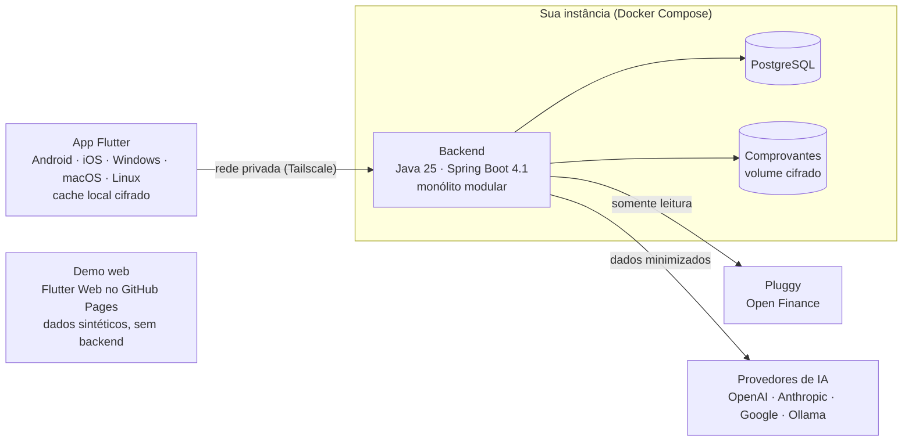

<div align="center">

# GranaPaCá

**Todas as suas contas num só lugar, na sua própria máquina.**

App de finanças pessoais open source e self-hosted: Open Finance via Pluggy, categorização por regras e IA, e privacidade em primeiro lugar.

[](LICENSE)

[](https://github.com/igorgmassi/granapaca/actions/workflows/secret-scan.yml)

[English](README.en.md) · [Arquitetura](#arquitetura) · [Roadmap](#roadmap) · [Segurança](SECURITY.md) · [Contribuir](CONTRIBUTING.md)

</div>

> [!NOTE]
> **Em planejamento.** Ainda não existe versão utilizável. Este repositório guarda a documentação e as decisões de arquitetura enquanto a Fase 0 (fundação) começa.

## O que é

O GranaPaCá reúne as contas de vários bancos num só lugar, via Open Finance: saldo, extrato, cartões e faturas, com o histórico completo de gastos e ganhos. Regras e IA categorizam cada transação, e um chat responde perguntas sobre as suas finanças mostrando os números e o período usados.

Cada pessoa roda a própria instância (self-hosted, single-tenant), com as próprias credenciais da Pluggy e dos provedores de IA. Não existe servidor central: quem mantém o projeto não tem acesso aos dados de ninguém.

## Princípios

- **Privacidade primeiro.** Os dados ficam na sua instância, segredos nunca chegam ao app e nada vai para a IA sem minimização.
- **Somente leitura.** O app nunca inicia pagamentos nem movimenta dinheiro.
- **IA como assistente, não como decisora.** Toda classificação vem com explicação e pode ser corrigida; regras sugeridas pela IA só valem depois de confirmadas.
- **Rótulos sem julgamento.** Essencialidade em três níveis: Essencial, Importante e Flexível.
- **Dado do banco preservado.** Correções ficam numa camada própria, com histórico, e a sincronização diária nunca apaga uma correção.
- **Seguro por padrão.** Não existe credencial padrão, e o sistema não sobe sem chave mestra e senha forte.

## Funcionalidades planejadas

| Área | O que faz | Quando |
|---|---|---|
| Modo demo | Testar no navegador com dados 100% sintéticos, sem conectar banco | MVP |
| Contas e bancos | Conexão via Meu Pluggy, extrato consolidado e por banco, status de cada conexão | MVP |
| Categorização por regras | Regras do usuário, do perfil e do sistema, com correção manual, histórico e desfazer | MVP |
| Gráficos | Rosca por categoria e ranking das categorias que mais pesam | MVP |
| Guia inicial | Perfil por ocupação, casa e transporte, que define o que é essencial para você | Depois do MVP |
| Dinheiro físico | Lançamento rápido de gastos em espécie, funcionando offline | Depois do MVP |
| IA | Categorização do que as regras não resolvem e chat com ferramentas somente leitura, com a sua chave da OpenAI, Anthropic ou Google, ou um modelo local no Ollama | Depois do MVP |
| Comprovantes e NFC-e | Fotos, PDFs e QR Code da nota fiscal, com os itens virando partes da transação | Depois do MVP |
| Planejamento e alertas | Orçamentos, metas, projeções, assinaturas esquecidas e alertas proativos | Depois do MVP |
| Exportação e importação | CSV, XLSX, PDF, backup completo em JSON e importação de OFX/CSV | Depois do MVP |

## Arquitetura



Só o backend fala com a Pluggy e com os provedores de IA, então segredos nunca chegam ao app. Por padrão, a API fica numa rede privada (Tailscale), sem exposição na internet. A demo web roda sozinha no navegador, sem backend.

## Stack de referência

| Camada | Tecnologia |
|---|---|
| App (mobile, desktop e demo web) | Flutter e Dart 3 |
| Backend | Java 25 (LTS), Spring Boot 4.1 e Spring Modulith |
| Dados | PostgreSQL e Flyway |
| IA | Spring AI, com OpenAI, Anthropic, Google e Ollama |
| Integração bancária | Pluggy (Meu Pluggy) e importação de OFX/CSV |
| Infraestrutura | Docker Compose (amd64 e arm64), Tailscale e Caddy opcional |
| Qualidade | GitHub Actions, JUnit 5, Testcontainers e flutter_test |

Cada escolha relevante vira um ADR em [`docs/adr`](docs/adr), e qualquer troca na stack passa por um ADR novo.

## Estrutura do repositório

```text
granapaca/
├── app/        # app Flutter (mobile, desktop e demo web)
├── backend/    # API e jobs em Spring Boot
├── profiles/   # perfis do guia inicial, em YAML
├── infra/      # Docker Compose, Caddy e guias de instalação
└── docs/       # ADRs e documentação
```

## Roadmap

1. **Fase 0, Fundação:** repositório, CI, base de segurança e esqueletos do app e do backend.
2. **Fase 1, Demo navegável:** Flutter Web com dados sintéticos, publicado no GitHub Pages.
3. **Fase 2, Dados reais:** conexão com a Pluggy, sincronização diária e extrato por banco.
4. **Fase 3, MVP:** categorização por regras, correção manual com histórico e os dois primeiros gráficos.

Depois do MVP vêm o guia inicial, dinheiro físico, IA, comprovantes e nota fiscal, planejamento, alertas e exportação.

## Rodando a sua instância

Ainda não há versão instalável. Quando houver, um único `docker compose up` vai subir backend e banco no seu computador ou numa VM acessada pelo Tailscale, e o guia ficará em [`infra/`](infra/).

Cada pessoa cria a própria conta na Pluggy e conecta os próprios bancos no Meu Pluggy. Esse modo é para uso pessoal e não comercial; confira os termos atuais da Pluggy antes de usar.

## Segurança e privacidade

- Vulnerabilidade nunca vai em issue pública: use o [relato privado](SECURITY.md).
- Nunca cole extratos, prints, CPF, números de conta, tokens ou chaves em issues, PRs ou commits. Use dados sintéticos.
- O repositório contém só código e documentação. Credenciais ficam no `.env` de cada instância, fora do Git.

## Contribuindo

Contribuições são bem-vindas, inclusive perfis novos para o guia inicial. Leia o [guia de contribuição](CONTRIBUTING.md) e o [código de conduta](CODE_OF_CONDUCT.md).

## Licença

[GNU AGPL-3.0](LICENSE). Você pode usar, estudar, modificar e hospedar o GranaPaCá. Quem oferecer uma versão modificada como serviço em rede precisa disponibilizar o código-fonte dessa versão a quem a usa.

O GranaPaCá não é afiliado à Pluggy nem a nenhum banco. Os nomes citados pertencem aos respectivos donos.
