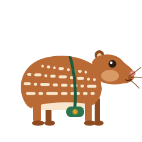
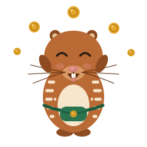
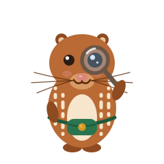
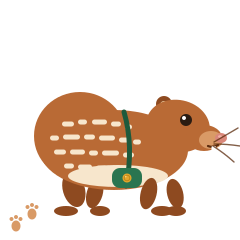
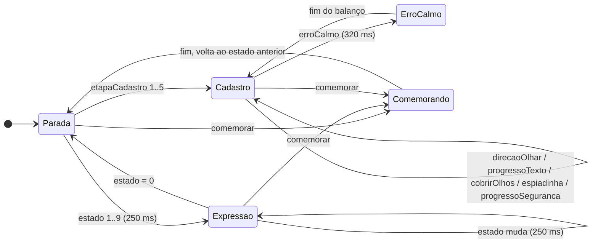

# Parte 3: Mascote

A Paçoca está desenhada em 12 SVGs: 3 vistas e 9 expressões, todas geradas pelas mesmas peças. Eles servem de referência para a ilustração final no Rive e de quadro parado dentro do app.

- **Data:** 2026-11-10; atualizado para Toca Editorial em 2026-11-24
- **Arquivos:** pasta [`mascote`](mascote/). Para regenerar depois de mudar uma peça: `node docs/design/mascote/gerar-pacoca.mjs`.

## Folha de modelo

| Frente | Perfil | Costas |
|---|---|---|
|  |  |  |

- **Corpo:** esguio, como nas fotos de paca usadas de referência. De frente ela fica em pé, para os gestos; de perfil e andando, fica em quatro patas, com a garupa alta.
- **Cara de paca:** focinho alongado com nariz rosado, orelhas pequenas e bigodes longos. Os dentes da frente aparecem só com a boca aberta.
- **Listras de pintas:** fileiras de traços creme, longos e curtos, que acompanham o comprimento do corpo, como na paca de verdade. De lado, são quatro fileiras na horizontal, com pintas curtas em cima e traços longos embaixo. Em pé, o corpo fica na vertical e as fileiras também: duas colunas em cada lateral. São a marca registrada dela.
- **Barriga limpa:** na versão refinada Toca Editorial, a barriga creme é contínua e sem acessórios na cintura, mantendo a silhueta nítida em qualquer tamanho. (As pranchas antigas da pasta `mascote/` ficam preservadas apenas como referência histórica de proporção.)
- **Traço:** vetorial plano, formas redondas, sem contorno preto e no máximo 3 tons por cor.

| Cor | Tons |
|---|---|
| Caramelo do corpo | #D99A66, #B96A35, #8E4A20 |
| Creme (focinho, barriga e pintas) | #F7E6CC, #E6C9A0 |
| Moedas | #F7D27A, #E5A62B, #B98318 |
| Olhos, boca e bigodes | #2A1C12, #5A2A0C |
| Nariz | #F0B0A6, #D9877A |

A Paçoca tem as mesmas cores nos dois temas. O caramelo do corpo nos SVGs de referência (`#B96A35`) fica acima de 3:1 nos quatro fundos: 3,83:1 no Algodão (`#FAF8F5`), 4,06:1 na Superfície clara (`#FFFFFF`), 4,63:1 na Toca Noturna (`#14110F`) e 4,26:1 na Superfície escura (`#1E1A17`); na versão ilustrada (`#C97C44`), fica acima de 3,07:1 no claro e 5,31:1 no escuro.

## Expressões

| Desenho | Expressão | Quando aparece | `estado` no Rive |
|---|---|---|---|
|  | Acenando | Boas-vindas e guia inicial | 1 |
|  | Comemorando, com moedinhas pulando | Meta batida, mês com sobra | 2 |
|  | Pensando, com a pata no queixo e três pintas no lugar do balão | IA processando, chat digitando | 3 |
|  | Com lupa | Lendo nota fiscal ou comprovante | 4 |
|  | Dormindo | Sem internet, sincronização pendente | 5 |
|  | Mergulhando | Atualizando os dados ao puxar a tela | 6 |
|  | Preocupada, sem drama | Alertas e conexão vencendo | 7 |
|  | Segurando um cadeado | Telas de privacidade e segurança | 8 |
|  | Andando, deixando pegadas | Guia inicial e transições de jornada | 9 |

O `estado` 0 é a Paçoca parada, igual à vista de frente.

## Regras de uso

- **No máximo uma vez por tela.**
- **Nunca** em listas de transações, nem ao lado de valor negativo em tom de piada.
- **Em alerta,** só a preocupada, sem drama. Em erro que envolve dinheiro, ela não brinca.
- **Fundo:** Superfície clara/escura (`surfaceContainerLow`) ou fundo principal (`surface`: Algodão / Toca Noturna). Nunca sobre foto nem sobre a cor de um banco.
- **Não mexer no desenho:** sem recolorir, esticar, girar ou pôr contorno.
- **Texto fora do desenho:** as falas vão num cartão editorial limpo (`FalaDaPacoca`) ao lado da Paçoca, no estilo `falaPacoca` (`Plus Jakarta Sans`, 16 px, peso 500).
- **Leitor de tela:** quando a frase ao lado já diz o estado, a Paçoca é decorativa e fica fora da leitura. Quando ela é o único sinal, ganha rótulo, como "A Paçoca está dormindo: sem internet".

| Uso | Tamanho | Recorte |
|---|---|---|
| Avatar do chat | 40 px | Só a cabeça |
| Puxar para atualizar | 48 px | Mergulhando |
| Fala da Paçoca num cartão | 64 px | Corpo inteiro |
| Estado vazio | 120 px | Corpo inteiro |
| Primeiro acesso | 160 a 240 px | Corpo inteiro |

Abaixo de 48 px, só a cabeça: o corpo vira um borrão e as pintas somem.

## Máquina de estados no Rive

O arquivo `pacoca.riv` tem dois artboards: **Paçoca** (512 × 512, corpo inteiro) e **Cabeça** (256 × 256, para o avatar do chat). Uma única máquina de estados, `pacoca`, controla os dois — tanto as expressões gerais do app quanto a coreografia da criação de conta.

| Entrada | Tipo | Valores | Para quê |
|---|---|---|---|
| `estado` | Número | 0 a 9, como na tabela de expressões | Expressões gerais do app |
| `profundidade` | Número | 0 a 100 | Quanto ela já mergulhou ao puxar a tela |
| `etapaCadastro` | Número | 0 a 5 (0 fora do cadastro; 1 modo, 2 e-mail, 3 senha, 4 segurança, 5 pronto) | Ativa os estados interativos da criação de conta |
| `direcaoOlhar` | Número | −1 a 1 | Direção do olhar entre as opções de acesso (`etapaCadastro = 1`) |
| `progressoTexto` | Número | 0 a 1 | Acompanhamento horizontal do olhar ao digitar (`etapaCadastro = 2`) |
| `cobrirOlhos` | Booleano | `false` / `true` | Levanta as duas patas cobrindo os olhos (`etapaCadastro = 3`) |
| `espiadinha` | Booleano | `false` / `true` | Afasta apenas uma pata ao mostrar senha (`etapaCadastro = 3`) |
| `progressoSeguranca` | Número | 0 a 3 | Acende as 3 pintas do escudo/cadeado (`etapaCadastro = 4`) |
| `erroCalmo` | Gatilho | — | Balanço calmo de cabeça em erro de código/credencial (`320 ms`) |
| `comemorar` | Gatilho | — | Pulinho comemorativo / chuva de moedas, depois volta ao estado anterior |

- **Camadas:** pose (os estados acima), olhos (piscada a cada 3 a 6 s, desligada quando ela dorme, comemora ou mergulha) e respiração (escala de 1,00 a 1,02 em 4 s, em loop).
- **Transições:** 250 ms com a curva `padrao`. Para dormir, 400 ms.
- **Quadros parados:** os SVGs desta pasta vão para `assets/pacoca/`. O app usa o SVG no lugar da animação com "reduzir movimento" ligado, nos testes de golden e na demo web enquanto o Rive carrega.
- [Conferir: pub.dev/packages/rive, a API de máquina de estados e de entradas no runtime atual para Flutter.]

## Paçoca ilustrada

As telas da [Parte 6](06-telas-a.md) em diante usam a Paçoca ilustrada: 12 poses em [`mascote/ilustrada`](mascote/ilustrada), com fundo transparente.

| Pasta ou arquivo | O que é |
|---|---|
| `origem/pacoca-NN-nome.png` | A arte de cada pose sobre fundo branco, sem perda. É a entrada. |
| `pacoca-NN-nome.png` | A pose recortada, com transparência suave. É o que o app e as telas usam. |
| `recorte.mjs` | Gera os recortes e o `telas/pacoca-mini.json`. |
| `partes.mjs` | Gera a pose de frente separada em partes, com a animação de exemplo. |

### Como o recorte é feito

- **O problema do recorte simples:** apagar o branco deixa a borda serrilhada e uma franja clara, porque os pixels da borda são uma mistura do desenho com o fundo.
- **O que o `recorte.mjs` faz:** para cada pixel da borda, procura em volta a cor do interior que melhor explica aquele pixel como mistura com o branco. A transparência é a proporção dessa mistura, e a cor do pixel passa a ser a cor limpa.
- **Bigodes:** são finos demais para ter interior. Usam a cor dos seus pixels mais escuros.
- **Brancos que ficam:** o brilho dos olhos fica sozinho, por estar cercado de cor escura. Os dentes ficam por uma lista de exceções no script.
- **Conferência automática:** o recorte posto de volta sobre o branco tem de dar a imagem de origem. O script falha se mais de 0,5% dos pixels fugir disso (hoje, no máximo 0,10%).
- **Para regenerar:** `npm install --no-save --prefix docs/design sharp` uma vez, depois `node docs/design/mascote/ilustrada/recorte.mjs` e `node docs/design/telas/gerar-telas-a.mjs`.

### Pose em partes, para animar

A pose de frente está separada em **corpo**, **cabeça** e **olhos**. O corpo sobe 6 px por baixo da cabeça, para a junta do pescoço não abrir quando ela gira. A animação de exemplo respira, inclina a cabeça 2,2° e pisca; com "reduzir movimento" ligado, fica parada.

- **No Rive:** importar o PNG recortado, cortar as mesmas partes e usar as mesmas medidas (pivô da cabeça em 108, 130; olhos em 71, 62 e 144, 62) [Conferir: rive.app/docs, importação de imagens e malhas].
- **Peças soltas, para montar e animar:** [`mascote/ilustrada/partes`](mascote/ilustrada/partes) guarda o estudo modular anterior com 10 peças desenhadas inteiras (cabeça, cabeça de olhos fechados, tronco, acessório de cintura legado, dois braços, duas pernas, braço acenando e boca aberta). Vieram de 5 folhas geradas inicialmente para recorte com o `recorte.mjs`; na versão refinada Toca Editorial, o acessório de cintura não é montado.

- **Versão refinada Toca Editorial (2026-11-24):** preserva o acabamento ilustrado suave sem contorno preto, mas **remove a pochete verde da cintura** (deixando a barriga creme contínua e limpa em qualquer tamanho) e **alonga suavemente o focinho** com bochechas arredondadas de paca brasileira e fileiras limpas de pintas creme nas laterais.
- **Camadas para animação nativa e Rive:** corpo/tronco com pintas, cabeça, pupilas móveis, pálpebras (piscada natural a cada 3–6 s), patas esquerda e direita independentes, escudo/cadeado de segurança e 3 pintas-moedinhas comemorativas.

## Coreografia na criação de conta (5 animações aprovadas)

Na criação de conta, a Paçoca fica apoiada diretamente sobre a borda superior do cartão de cadastro (sem cenário poluído ao fundo) e reage a cada interação:

| Etapa | Ação da pessoa | Reação animada da Paçoca | Entradas na máquina `pacoca` |
|---|---|---|---|
| **1. Modo de acesso** | Alterna entre *No celular*, *Meu servidor* e *Demo* | Respiração leve, piscada natural e rotação suave da cabeça/olhar para o cartão selecionado | `etapaCadastro = 1` + `direcaoOlhar` (−1 a 1) |
| **2. Nome / E-mail** | Digita no campo de texto | *Eye tracking*: pupilas e leve inclinação do focinho acompanham o comprimento do texto da esquerda para a direita | `etapaCadastro = 2` + `progressoTexto` (0 a 1) |
| **3. Senha / PIN** | Foca no campo de senha (ou alterna "mostrar senha") | Levanta as duas patas cobrindo os olhos (`cobrirOlhos`, 220 ms); se tocar no olhinho para revelar a senha, afasta apenas uma pata numa **espiadinha** discreta (`espiadinha`, 180 ms) | `etapaCadastro = 3` + `cobrirOlhos` / `espiadinha` |
| **4. Segurança (2FA / Biometria)** | Digita código de 6 números, ativa biometria ou erra código | Segura um escudo/cadeado luminoso cujas 3 pintas acendem conforme o progresso; em caso de erro, faz um balanço calmo de cabeça (`erroCalmo`, 320 ms), sem drama | `etapaCadastro = 4` + `progressoSeguranca` (0 a 3) + `erroCalmo` |
| **5. Toca pronta!** | Conclui a criação da conta | Pulinho comemorativo elástico (`pulinhoConclusao`, 520 ms) com 3 pintas-moedinhas subindo em arco limpo | `etapaCadastro = 5` + `comemorar` |

> **Reduzir movimento:** com `MediaQuery.disableAnimations` ativo, cada etapa mostra diretamente a pose correspondente (sem *eye tracking* contínuo, pulo ou partículas) com transição suave de 150 ms.

## Próximo

[Parte 4](04-logo-e-icone.md): logo e ícone do app (Opção B — Paca Deitada Evoluída).

