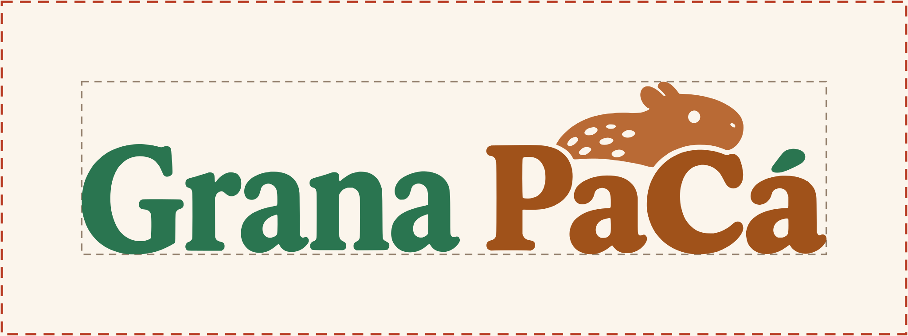
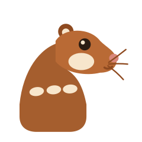
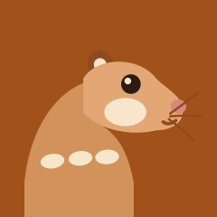
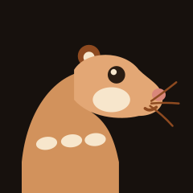
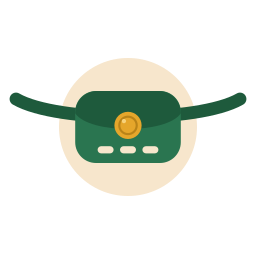
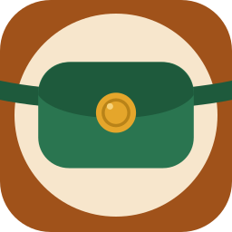

# Parte 4: Logo e ícone

O logo é o nome Grana PaCá num letreiro serifado, com "Grana" em verde Mata e "PaCá" em Caramelo, a paca deitada sobre o nome e o acento do á em forma de pinta. O ícone é a pochete verde da Paçoca sobre Caramelo, com a fivela de moeda e três pintas creme costuradas na frente. Tudo está em SVG na pasta [`logo`](logo/).

- **Data:** 2026-11-10; símbolo e ícone refeitos em 2026-11-11; logo refeito em 2026-11-12
- **Para regenerar:** `node docs/design/logo/gerar-logo.mjs`
- **Conferido com:** a skill logo-design (auditoria dos SVGs e folha de testes com tamanhos, fundos, uma cor, invertido, borrado, espelhado e girado).

## Logo

| Versão | Arquivo | Onde usar |
|---|---|---|
|  | `logo-cor.svg` | Fundo claro: README, telas, apresentação |
|  | `logo-escuro.svg` | Fundo escuro e tema escuro |
|  | `logo-mono.svg` | Uma cor só: carimbo, gravação, impressão em preto. Usa a cor do texto em volta (`currentColor`). |

**O que cada parte diz.** "Grana" é verde, a cor do dinheiro guardado. "PaCá" é Caramelo, a cor da paca. A paca deitada sobre "PaCá" tem as fileiras de pintas que a diferenciam de outros roedores. O acento do á é uma pinta solta.

**Por que serifa.** O pedido era um logo criativo e aconchegante, com um mínimo de seriedade de empresa. A serifa de curvas cheias dá o ar de marca estabelecida, e a paca tira a frieza. O bicho por cima da segunda palavra segue o padrão de logos como o do MySQL: o nome fica intacto e o animal dá personalidade.

**Como foi construído.** A arte veio de um estudo com seis letreiros em preto e branco. O escolhido foi traçado em vetor e separado em quatro partes (Grana, PaCá, paca e acento), guardadas em [`letreiro.json`](logo/letreiro.json). O gerador só aplica as cores. As letras são contornos: o logo não depende de fonte instalada.

**A pochete não entra no logo.** Ela é o ícone do app. O logo e a pochete nunca aparecem montados juntos.

**Revisão do briefing.** O nome do logo voltou a ser "Grana PaCá", com espaço, como no briefing. O repositório e o identificador do app continuam `granapaca`.

### Área de respiro

A área livre em volta do logo é a altura do "a" minúsculo. Nenhum texto, borda ou outro logo entra nela. O tracejado cinza é a caixa do logo; o vermelho é o limite da área livre.

### Tamanhos mínimos

| Uso | Tela | Impressão |
|---|---|---|
| Logo | 120 px de largura | 30 mm de largura |
| Abaixo disso | Use o ícone do app ou o favicon | — |

Com 96 px de largura o nome ainda é lido, mas as pintas da paca viram ruído. Por isso o mínimo é 120 px.

## Símbolo

A pochete da Paçoca: a bolsa verde Mata, a tampa num verde mais escuro, a fivela em forma de moeda e três pintas creme alongadas, como as fileiras de pintas da paca. As pintas são traços arredondados, não círculos: redondas e com anel, pareciam botões de camisa. No símbolo a alça é um trecho curto do mesmo arco do ícone, com as pontas arredondadas. Com as pontas subindo mais, ela parecia chifre ou bigode.

## Ícone do app

### Por que a pochete

O primeiro ícone era a cabeça da Paçoca de perfil. Em 48 px ela parecia um bicho marrom qualquer. As cinco versões ilustradas feitas depois no Gemini ficaram detalhadas demais para o tamanho, ou engraçadinhas demais para um app de dinheiro. Ícone de app pede uma ideia só, numa forma compacta. Comparei quatro caminhos abstratos: a pochete; a silhueta da paca, que parecia porquinho e depois anta; os olhos brilhando na toca; e o G do letreiro com uma moeda. A pochete ganhou porque:

- é a assinatura visual da Paçoca, presente em todas as poses da [mascote](03-mascote.md);
- guarda a grana, e a fivela é uma moeda;
- leva as pintas da paca, costuradas na frente;
- o verde Mata é o oposto do Caramelo no círculo de cores.

| iOS claro | iOS escuro | iOS tingido | Android | Android temático |
|---|---|---|---|---|
|  |  |  |  |  |

A pochete fica sobre um disco creme, no centro óptico (um pouco acima do meio). A alça atravessa o disco e sai pelas bordas, como um cinto. O disco separa a bolsa verde do Caramelo (veja [Cores e contraste](#cores-e-contraste)). No iOS o quadro aparece inteiro. No Android só os 72 dp do meio aparecem, então a camada da frente usa a mesma composição em 2/3 do tamanho, e o disco inteiro cabe no círculo seguro.

| Arquivo | Plataforma | O que é |
|---|---|---|
| `icone-ios-claro.svg` | iOS | Quadro inteiro de 1024 px; o sistema arredonda os cantos. |
| `icone-ios-escuro.svg` | iOS | Aparência escura, sobre o fundo Paçoca escuro (#17110D). |
| `icone-ios-tingido.svg` | iOS | Aparência tingida: tons de cinza sobre fundo transparente; o sistema aplica a cor. |
| `icone-android-fundo.svg` | Android | Camada de fundo do ícone adaptativo: Caramelo chapado. |
| `icone-android-frente.svg` | Android | Camada da frente. O essencial fica no círculo seguro de 66 dp dentro da camada de 108 dp. |
| `icone-android-mono.svg` | Android | Camada monocromática dos ícones temáticos: só a forma, com a linha da tampa, a moeda e as pintas vazadas. |
| `favicon.svg` | Web | Demo web: cantos arredondados, sem as pintas, com o disco e a pochete maiores, para 16 a 32 px. |

### Tamanhos pequenos

| 48 px | 24 px | Favicon 32 px | Favicon 16 px |
|---|---|---|---|
|  |  |  |  |

Em 48 px aparecem a bolsa, a tampa, a moeda e as pintas. Em 24 px as pintas viram uma linha clara e a moeda vira um ponto dourado, mas a forma da pochete continua. O favicon tira as pintas e aumenta a bolsa para ser lido em 16 px.

## Cores e contraste

| Par | Contraste |
|---|---|
| Logo: "Grana" (verde Mata) sobre o fundo Paçoca | 5,15:1 |
| Logo: "PaCá" (Caramelo) sobre o fundo Paçoca | 5,21:1 |
| Logo: a paca sobre o fundo Paçoca | 3,74:1 |
| Logo escuro: "Grana", "PaCá" e a paca sobre o fundo escuro | 8,97:1, 8,60:1 e 7,81:1 |
| Bolsa verde sobre o fundo Caramelo | 1,01:1 (por isso o disco) |
| Disco creme sobre o fundo Caramelo | 4,61:1 |
| Bolsa sobre o disco creme, e pintas sobre a bolsa | 4,56:1 |
| Bolsa sobre o fundo escuro | 3,35:1 |
| Símbolo sobre o fundo Paçoca: tampa e alça | 7,50:1 |
| Símbolo sobre o fundo Paçoca: bolsa | 5,15:1 |

O verde Mata e o Caramelo têm quase a mesma luminância. Direto sobre o Caramelo, a pochete só se separa do fundo pela cor: some em escala de cinza e vira uma mancha com 32 px. Testei três correções em cor, em cinza e com simulação de deuteranopia e de protanopia (Machado 2009): um anel creme em volta da bolsa, um disco creme atrás dela e um fundo escuro. O escolhido foi o disco. Com ele, a bolsa fica a 4,56:1 do creme e o creme a 4,61:1 do Caramelo. A alça, onde passa fora do disco, fica em 1,44:1, mas é detalhe. No fundo escuro a bolsa já passa de 3:1, então o ícone escuro não tem disco. A moeda fica em 2,61:1 sobre a bolsa, mas ela é detalhe: a forma que identifica o ícone é a pochete. O ícone usa 7 cores, contando o fundo, e cada cor tem um papel.

## Usos proibidos

- Recolorir fora das versões desta página, esticar, girar ou inclinar.
- Pôr contorno, sombra, brilho ou degradê.
- Montar a pochete junto do logo, de qualquer jeito.
- Trocar o letreiro por texto digitado em qualquer fonte.
- Tirar a paca ou o acento do logo, ou usá-los soltos.
- Usar o logo abaixo do tamanho mínimo, em vez do ícone.
- Pôr o símbolo sobre Caramelo: nesse fundo, use o ícone, com o disco creme.
- Tirar o disco do ícone claro, ou pôr o disco no ícone escuro ou no símbolo.

## A conferir

- **Android:** as medidas das camadas (108 dp, área visível de 72 dp e círculo seguro de 66 dp) e o formato aceito para a camada monocromática [Conferir: developer.android.com, ícones adaptativos].
- **iOS:** as três aparências (clara, escura e tingida) e os ícones em camadas do iOS 26, feitos no Icon Composer [Conferir: Apple Human Interface Guidelines, App icons].
- **Exportação:** o pacote flutter_launcher_icons pede imagens PNG [Conferir: pub.dev/packages/flutter_launcher_icons]. Os PNGs saem destes SVGs na Parte 12, com o script `render_png.py` da skill logo-design.
- **Traços:** a alça da pochete é um traço (stroke). Para gravação, recorte ou bordado, expanda o traço num editor vetorial. O logo já é feito só de contornos. O ícone monocromático usa máscara, então ele é exportado em PNG.
- **Letreiro:** as letras do logo vieram de um gerador de imagem e foram traçadas em vetor. Antes de lançar, comparar com fontes comerciais parecidas e fazer a busca de marca [Conferir: INPI].
- **Traçado:** os contornos são de um traçado automático. Uma limpeza manual das curvas num editor vetorial reduz os 863 pontos e melhora a impressão grande.

## Próximo

Parte 5: biblioteca de componentes.
