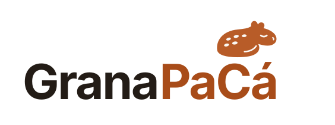
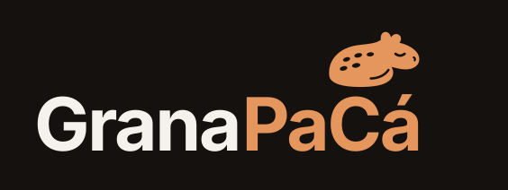
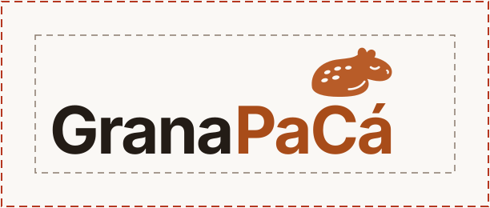
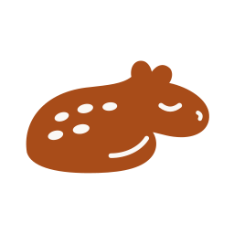
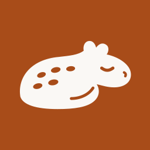
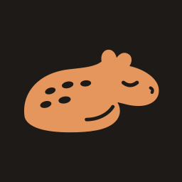
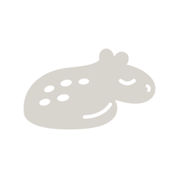
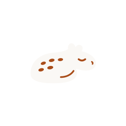
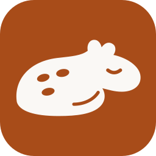

# Parte 4: Logo e ícone

O logo oficial é a **Opção B — Paca Deitada Evoluída**: o nome **Grana PaCá** em tipografia geométrica limpa sem serifa (`Plus Jakarta Sans Bold`), com "Grana" em Cacau (ou Off-white no escuro), "PaCá" em Terracota (ou Âmbar no escuro) e a paca pintada **sem contorno preto** descansando tranquilamente sobre "PaCá". O ícone do app usa a própria silhueta limpa da paca deitada. Tudo está em SVG na pasta [`logo`](logo/).

- **Data:** 2026-11-10; atualizado para Toca Editorial (Opção B) em 2026-11-24
- **Para regenerar:** `node docs/design/logo/gerar-logo.mjs`

## Logo

| Versão | Arquivo | Onde usar |
|---|---|---|
|  | `logo-cor.svg` | Fundo claro (`#FAF8F5` ou `#FFFFFF`): README, telas e apresentação |
|  | `logo-escuro.svg` | Fundo escuro (`#14110F`) e tema escuro |
|  | `logo-mono.svg` | Uma cor só (`currentColor`): impressão, carimbo e marca d'água |

**O que mudou na revisão Toca Editorial:**
- A serifa pesada anterior foi substituída pela família `Plus Jakarta Sans Bold`, unificando logo e interface.
- A paca sobre `PaCá` mantém o gesto afetivo original, agora **100% sem contorno preto**, com focinho suavemente alongado de paca, olho fechado sereno e fileiras limpas de pintas vazadas.
- A pochete saiu tanto da mascote quanto do ícone: a própria paca deitada entrega leitura imediata e contraste superior em qualquer tamanho.

### Área de respiro

A área livre em volta do logo equivale à altura da letra "a" minúscula. Nenhum texto, borda ou outro elemento entra nela.

### Tamanhos mínimos

| Uso | Tela | Impressão |
|---|---|---|
| Logo completo | 120 px de largura | 30 mm de largura |
| Abaixo disso | Use o símbolo ou o ícone do app | — |

## Símbolo e ícone do app (Paca Deitada)

A silhueta única da paca deitada funciona nativamente sem disco intermediário: creme algodão (`#FAF8F5`) sobre Terracota (`#A84C19`) no claro (**5,37:1**), Âmbar (`#E5965C`) sobre Obsidiana (`#1E1A17`) no escuro (**7,28:1**) e máscara vazada pura nos ícones temáticos do Android.

| iOS claro | iOS escuro | iOS tingido | Android (frente) | Android temático |
|---|---|---|---|---|
|  |  |  |  |  |

| Arquivo | Plataforma | O que é |
|---|---|---|
| `icone-ios-claro.svg` | iOS | Terracota `#A84C19` + paca creme `#FAF8F5` (quadro 1024 px). |
| `icone-ios-escuro.svg` | iOS | Obsidiana `#1E1A17` + paca âmbar `#E5965C`. |
| `icone-ios-tingido.svg` | iOS | Silhueta vazada neutra sobre fundo transparente para o tingimento do sistema. |
| `icone-android-fundo.svg` | Android | Camada de fundo sólida em Terracota `#A84C19`. |
| `icone-android-frente.svg` | Android | Paca creme centralizada dentro do círculo seguro de 66 dp (camada 108 dp). |
| `icone-android-mono.svg` | Android | Camada monocromática vazada (3 pintas ampliadas para nitidez em ícones temáticos). |
| `favicon.svg` | Web | Versão com cantos arredondados e 3 pintas maiores, legível em 16 px e 32 px. |

### Tamanhos pequenos

| 48 px | 24 px | Favicon 32 px | Favicon 16 px |
|---|---|---|---|
|  |  |  |  |

## Cores e contraste

| Par | Contraste |
|---|---|
| Logo claro: "Grana" (`#231C16`) sobre Algodão (`#FAF8F5`) | 15,86:1 |
| Logo claro: "PaCá" (`#A84C19`) sobre Algodão (`#FAF8F5`) | 5,37:1 |
| Logo escuro: "Grana" (`#F5F1EC`) sobre Toca Noturna (`#14110F`) | 16,72:1 |
| Logo escuro: "PaCá" e paca (`#E5965C`) sobre Toca Noturna (`#14110F`) | 7,71:1 |
| Ícone claro: paca creme (`#FAF8F5`) sobre Terracota (`#A84C19`) | 5,37:1 |
| Ícone escuro: paca âmbar (`#E5965C`) sobre Obsidiana (`#1E1A17`) | 7,28:1 |

## Usos proibidos

- Recolorir fora das versões desta página, esticar, girar ou inclinar.
- Colocar contorno preto ao redor da paca, sombra pesada ou brilho artificial.
- Separar a paca do wordmark ou recolocar a pochete antiga sobre o logo.
- Usar o logo abaixo de 120 px de largura (trocar pelo símbolo ou ícone).

## Próximo

[Parte 5](05-componentes.md): biblioteca de componentes.
