# Parte 5: Biblioteca de componentes

Os componentes do app, com os estados de cada um, nos temas claro e escuro. Quase todos são widgets do Material 3 com os tokens da [Parte 2](02-design-tokens.md). Só cinco são próprios do GranaPaCá.

- **Data:** 2026-11-12
- **Para regenerar:** `node docs/design/componentes/gerar-componentes.mjs`
- **De onde vêm as cores e as medidas:** do [`tokens.json`](tokens/tokens.json). As folhas não têm cor escrita à mão.
- **Fontes nas imagens:** o app usa Baloo 2 e Figtree. No GitHub, as folhas aparecem com a fonte do sistema, porque um SVG não carrega fontes de fora.
- **Dados:** fictícios, como em todo o repositório.

## Regras que valem para todos

| Regra | Valor |
|---|---|
| Área de toque | 48 × 48 no mínimo, mesmo quando o desenho é menor (chip de 32, chave, caixa de marcar) |
| Foco pelo teclado | Anel Caramelo (`primary`) de 2, afastado 2 do componente |
| Pressionado | Camada da cor do conteúdo com 10% de opacidade |
| Passar o mouse (desktop) | A mesma camada, com 8% |
| Desabilitado | Conteúdo com 38% de opacidade; fundo e borda com 12% do Cacau (`onSurface`) |
| Carregando | As três pintas no lugar do rótulo, com o botão na mesma largura |
| Erro | Borda e texto em Urucum (`error`), sempre com uma frase que diz o que fazer |
| Raio | Botão em pílula, campo e chip 12, cartão 20, folha e diálogo 28 |
| Sombra | Só no que flutua: botão de ação e folhas. Cartão não tem sombra, tem borda `outlineVariant` |

Cor nunca é o único sinal. Erro tem texto, seleção tem preenchimento e peso de fonte, e a essencialidade tem pintas e nome.

## Botões

| Claro | Escuro |
|---|---|
| 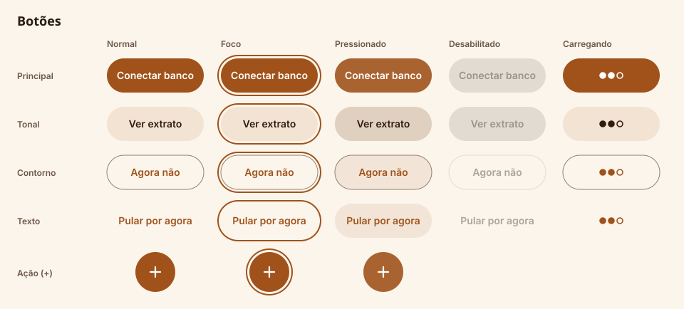 | 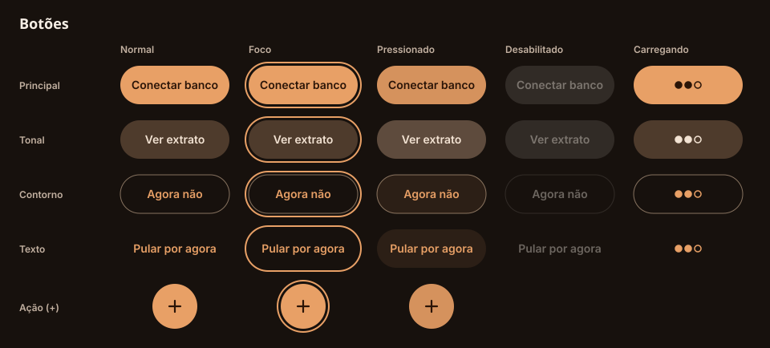 |

| Tipo | Widget do Flutter | Quando usar |
|---|---|---|
| Principal | `FilledButton` | A ação principal da tela. Um por tela. |
| Tonal | `FilledButton.tonal` | Ação secundária com peso, como "Ver extrato". |
| Contorno | `OutlinedButton` | Alternativa à ação principal, como "Agora não". |
| Texto | `TextButton` | Ação de baixo peso, como "Pular por agora" e "Desfazer". |
| Ação (+) | `FloatingActionButton` | Abre a folha de ações. Fica no meio da barra ou no topo do trilho. |

- Altura de 48 e rótulo no estilo `labelLarge`. O rótulo é um verbo e diz o que acontece: "Conectar banco", não "OK".
- No estado carregando, o botão não aceita toque e o leitor de tela anuncia "Carregando".
- Ação destrutiva usa o botão principal em Urucum, só dentro de diálogo de confirmação.

## Campos

| Claro | Escuro |
|---|---|
| 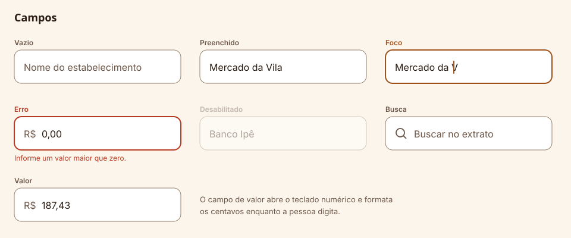 | 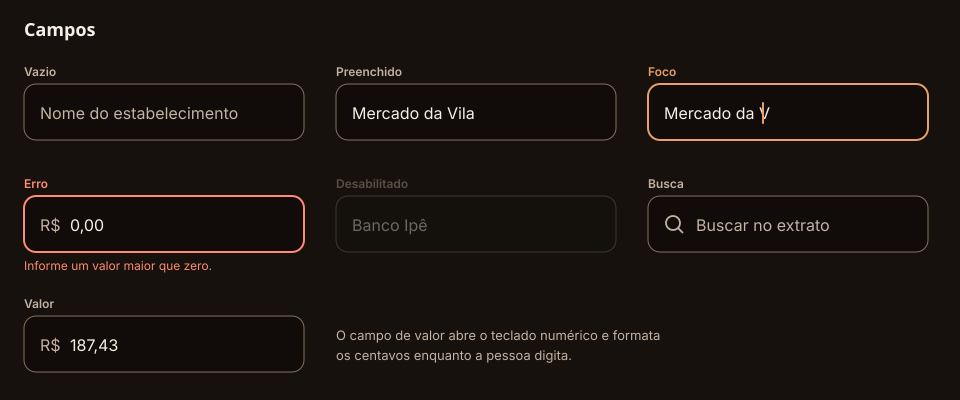 |

- **Widget:** `TextField` com `OutlineInputBorder`, altura de 56 e texto em `bodyLarge` (16). Com 16, o iPhone não dá zoom na tela ao focar o campo.
- **Rótulo:** fica sempre visível acima do campo. O texto de dica dentro do campo é só um exemplo e não substitui o rótulo.
- **Valor em dinheiro:** teclado numérico, prefixo "R$" fixo e centavos formatados enquanto a pessoa digita.
- **Erro:** aparece ao sair do campo, não a cada tecla. A frase fica embaixo e diz como corrigir.
- **Busca:** `SearchBar`, com a lupa à esquerda e o botão de limpar à direita quando há texto.

## Chips e seleção

| Claro | Escuro |
|---|---|
| 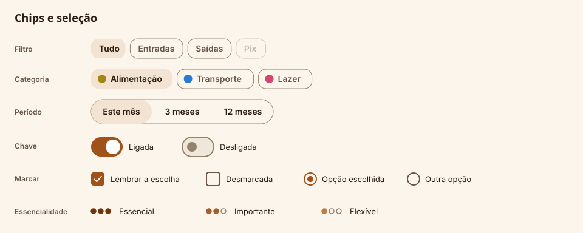 | 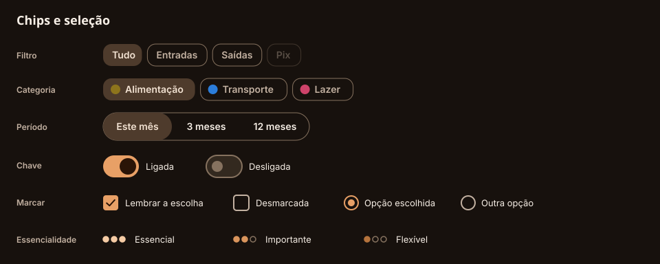 |

| Componente | Widget do Flutter | Observação |
|---|---|---|
| Chip de filtro | `FilterChip` | Selecionado: fundo `secondaryContainer` e sem borda. |
| Chip de categoria | `FilterChip` com `avatar` | A bolinha usa a cor da categoria; o nome vem sempre junto. |
| Período | `SegmentedButton` | Uma escolha por vez, com até 3 opções. |
| Chave | `Switch` | Liga e desliga na hora, sem botão de salvar. |
| Marcar | `Checkbox` e `Radio` | O texto ao lado também é área de toque. |
| Essencialidade | Próprio: `MarcadorDePintas` | ●●● Essencial, ●●○ Importante, ●○○ Flexível. |

O marcador de pintas vem sempre com o nome do nível. Onde o nome não cabe, as pintas ficam sozinhas e o nome vai para o rótulo de acessibilidade ([Parte 1](01-revisao-das-decisoes.md), mudança 7).

## Cartões e listas

| Claro | Escuro |
|---|---|
| 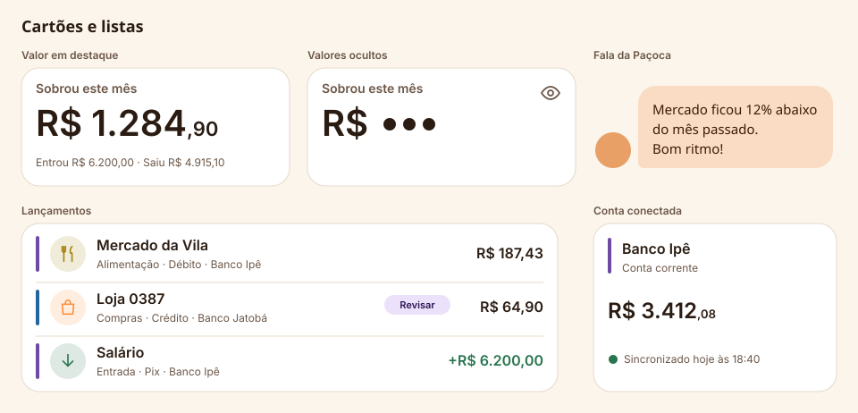 | 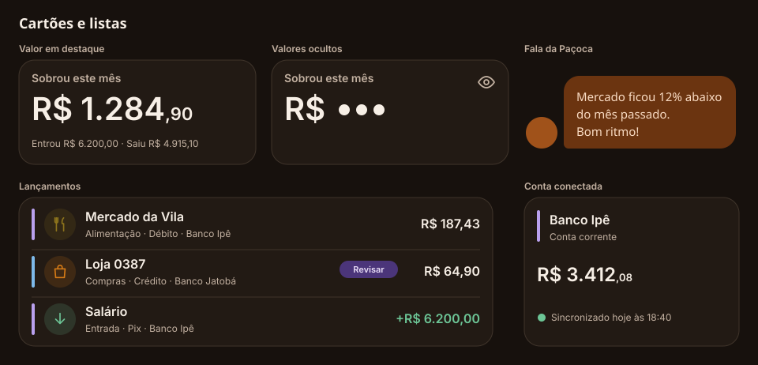 |

| Componente | Base | O que tem |
|---|---|---|
| Valor em destaque | `Card` | Rótulo, valor em `valorDestaque` com os centavos menores e uma linha de apoio. |
| Valores ocultos | O mesmo cartão | "R$" seguido de três pintas. O olho no canto mostra e esconde todos os valores do app. |
| Fala da Paçoca | Próprio: `FalaDaPacoca` | Balão `primaryContainer` com o texto em `falaPacoca` e a Paçoca ao lado. |
| Lançamento | Próprio: `LinhaDeLancamento` | Faixa do banco, círculo da categoria, nome, detalhes e valor. |
| Conta conectada | `Card` | Faixa do banco, nome, saldo em `valorGrande` e a hora da última sincronização. |

- **Lançamento:** o valor fica à direita, com algarismos de largura fixa. Entrada usa verde Mata e o sinal "+"; saída usa Cacau e não leva sinal. O nome é cortado com reticências se não couber, e o valor nunca é cortado.
- **"Revisar":** marca o lançamento que a IA classificou com pouca confiança. Tocar abre a correção da categoria.
- **Faixa do banco:** 4 de largura, na cor que vem do servidor ([Parte 1](01-revisao-das-decisoes.md), mudança 12).
- **Nas folhas, a Paçoca é um círculo.** No app entra o desenho da [Parte 3](03-mascote.md), na expressão que a situação pede.
- **Leitor de tela:** cada lançamento é lido como uma frase só: "Mercado da Vila, alimentação, débito no Banco Ipê, 187 reais e 43 centavos".

## Navegação

| Claro | Escuro |
|---|---|
| 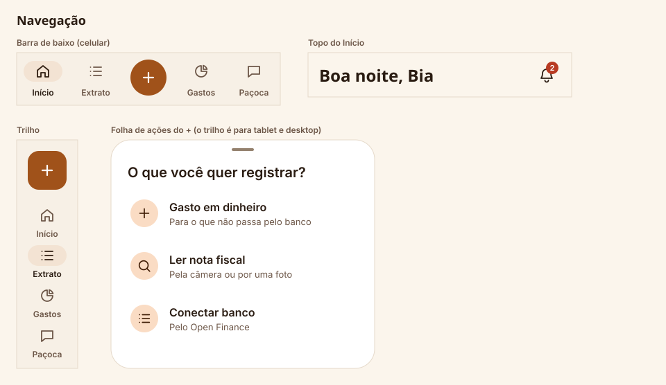 | 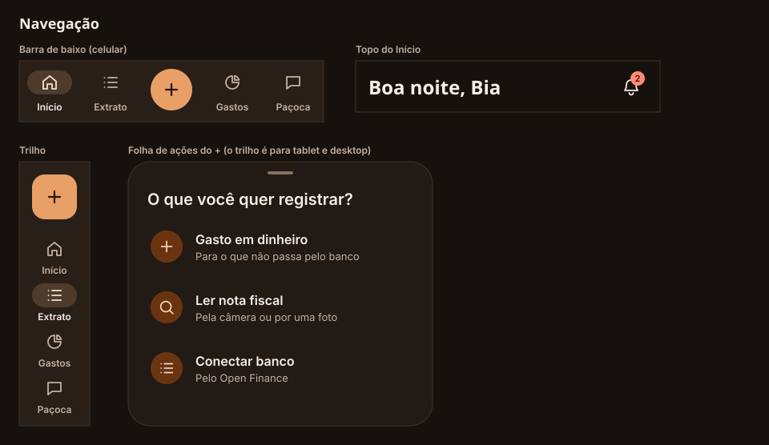 |

| Componente | Widget do Flutter | Onde aparece |
|---|---|---|
| Barra de baixo | `NavigationBar` | Celular, até 599 de largura. |
| Trilho | `NavigationRail` | Tablet e desktop, a partir de 600. |
| Folha de ações | `showModalBottomSheet` | Abre pelo "+". No desktop vira um menu ao lado do botão. |
| Sino com contador | `Badge` sobre `IconButton` | Topo do Início. |

- São 4 destinos (Início, Extrato, Gastos e Paçoca) e o "+" no meio, que é uma ação e nunca fica selecionado.
- O destino selecionado tem a pílula `secondaryContainer` atrás do ícone e o rótulo mais escuro. O rótulo aparece sempre, não só no selecionado.
- O contador do sino mostra até "9+". O rótulo de acessibilidade diz "Alertas: 2 novos".

## Avisos e estados

| Claro | Escuro |
|---|---|
| 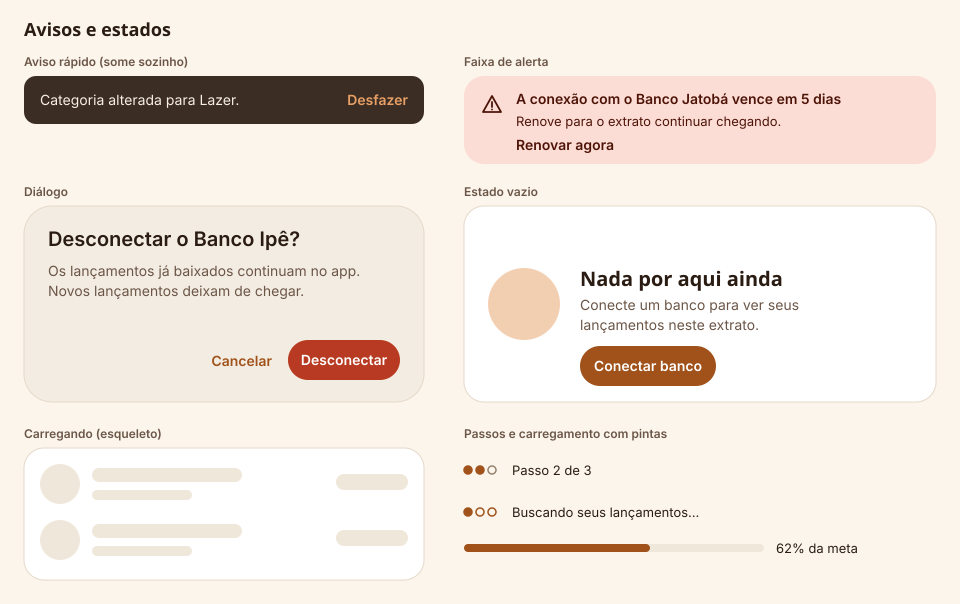 | 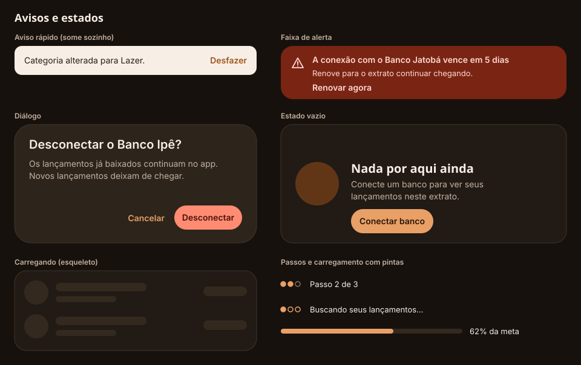 |

| Componente | Widget do Flutter | Quando usar |
|---|---|---|
| Aviso rápido | `SnackBar` | Confirma o que acabou de acontecer. Some em 4 segundos e pode ter "Desfazer". |
| Faixa de alerta | Próprio: `FaixaDeAlerta` | Algo que pede ação e não pode sumir, como uma conexão vencendo. |
| Diálogo | `AlertDialog` | Só para confirmar ação que não tem volta. |
| Estado vazio | Próprio: `EstadoVazio` | Tela ou lista sem dados: a Paçoca, uma frase e a próxima ação. |
| Esqueleto | Próprio | Enquanto a lista carrega. Tem a forma do conteúdo que vai chegar. |
| Pintas | Próprio: `MarcadorDePintas` | Passos de um guia e carregamentos curtos. |
| Barra de progresso | `LinearProgressIndicator` | Metas e orçamentos, sempre com o número ao lado. |

- **O título do diálogo é a pergunta,** e os botões respondem com o verbo: "Desconectar" e "Cancelar". Nunca "Sim" e "Não".
- **O aviso rápido não carrega erro importante.** Erro que impede a pessoa de continuar vai na tela, perto de onde aconteceu.
- **Movimento:** o esqueleto pulsa a cada 1 segundo e as pintas de carregamento alternam. Com "reduzir movimento" ligado, os dois ficam parados.
- **Leitor de tela:** o aviso rápido e a faixa de alerta são anunciados quando aparecem.

## Componentes próprios

| Componente | Por que não é do Material 3 |
|---|---|
| `MarcadorDePintas` | É o motivo da marca: escala de 1 a 3, passos e carregamento. |
| `LinhaDeLancamento` | Junta faixa do banco, categoria, texto e valor num alinhamento fixo. |
| `FalaDaPacoca` | Balão com a mascote e fonte da marca. |
| `FaixaDeAlerta` | O `MaterialBanner` ocupa a largura toda no topo; aqui o alerta é um cartão dentro da tela. |
| `EstadoVazio` | Padrão único para toda tela sem dados. |

## A conferir

- **Widgets:** nomes e propriedades de `FilledButton`, `SegmentedButton`, `NavigationBar`, `NavigationRail`, `SearchBar` e `Badge` na versão do Flutter usada [Conferir: api.flutter.dev, biblioteca material].
- **Camadas de estado:** as opacidades de foco, pressionado e desabilitado seguem o Material 3 [Conferir: m3.material.io, States].
- **Zoom no iPhone:** o Safari amplia a página ao focar um campo com texto menor que 16 px. Isso vale para a demo web, não para o app nativo [Conferir: comportamento do Safari no iOS].
- **Ícones:** as folhas usam traços desenhados à mão no estilo do Phosphor. No app entram os ícones do pacote `phosphor_flutter` [Conferir: pub.dev/packages/phosphor_flutter].
- **Ícones de categoria no escuro:** a cor de gráfico de algumas categorias fica com pouco contraste dentro do círculo. Medir na [Parte 11](README.md) e, se preciso, usar o tom claro da categoria no ícone.

## Próximo

[Parte 6](06-telas-a.md): telas do primeiro acesso e do Início.
