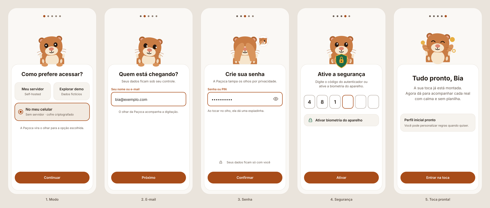
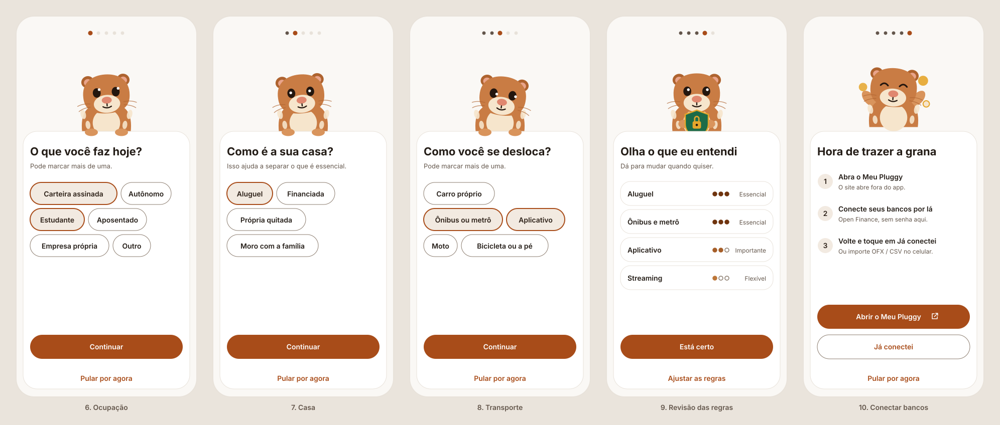
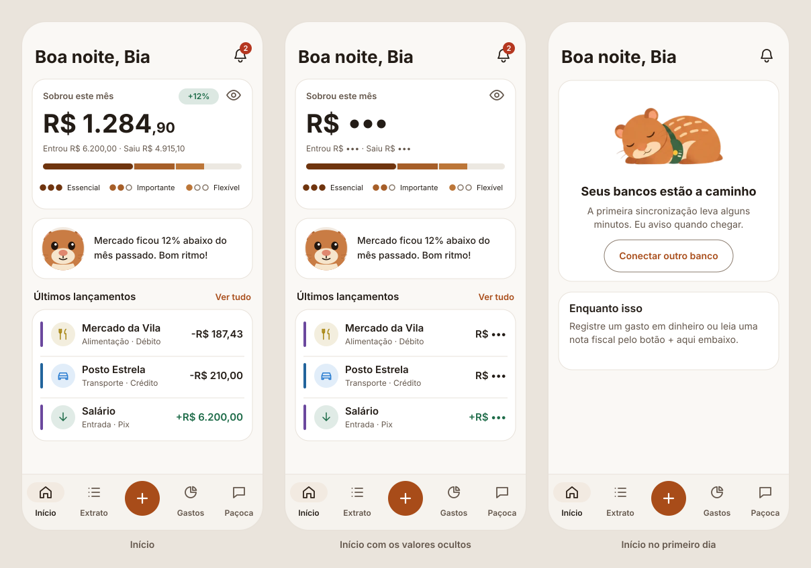
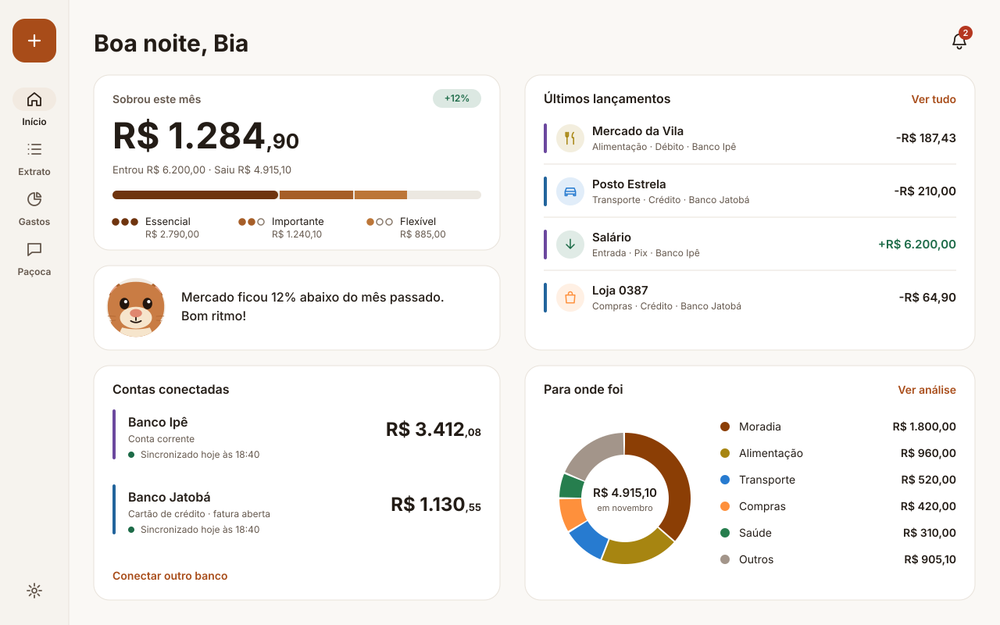

# Parte 6: Telas A, criação de conta animada e Início

As telas da Parte 6 seguem a identidade **Toca Editorial**: superfícies arejadas, cartões com borda fina, números tabulares em destaque e a **Paçoca refinada (sem pochete)** apoiada diretamente na borda superior do cartão de criação de conta, reagindo em tempo real a cada passo.

- **Data:** 2026-11-12; revisadas para Toca Editorial e criação de conta animada em 2026-11-24
- **Para regenerar:** `node docs/design/telas/gerar-telas-a.mjs`
- **De onde vem cada coisa:** tokens de [`tokens.json`](tokens/tokens.json), componentes da [Parte 5](05-componentes.md) e animações da Paçoca especificadas na [Parte 3](03-mascote.md).
- **Tamanho das telas:** celular de 360 × 760 e desktop de 1280 × 800.
- **Dados:** fictícios, como em todo o repositório.

## Criação de conta animada (Etapas 1 a 5)

Em vez de cenários estáticos de colinas atrás do formulário, cada etapa coloca a Paçoca diretamente sobre a borda do cartão limpo, com indicador minimalista de 5 pintas no topo:

No tema escuro: [criação de conta, etapas 1 a 5](telas/trilha-1-escuro.svg).

| Etapa | O que a tela pede | Animação da Paçoca | Pode pular? |
|---|---|---|---|
| **1. Modo** | Escolher *No meu celular* (local criptografado), *Meu servidor* ou *Explorar demo* | Olhar direcional e inclinação da cabeça seguindo o cartão selecionado + piscada natural | — |
| **2. E-mail** | Nome ou e-mail (e URL do servidor no modo self-hosted) | *Eye tracking* suave acompanhando a digitação da esquerda para a direita | Não |
| **3. Senha** | Senha da conta ou PIN do cofre local | **Tampando os olhos com as duas patas**; ao tocar em "mostrar senha", dá uma espiadinha afastando só uma pata | Não (opcional no modo local sem trava) |
| **4. Segurança** | Código de 6 dígitos (2FA) ou ativar biometria do aparelho | Segura o escudo/cadeado luminoso; balança a cabeça com calma em caso de erro | Biometria sim |
| **5. Toca pronta!** | Confirmar conclusão e entrar no app | Pulinho comemorativo com 3 pintas-moedinhas subindo em arco limpo | — |

## Guia rápido de perfil (Etapas 6 a 10)

Etapas opcionais para calibrar as regras iniciais (todas com "Pular por agora"):

No tema escuro: [guia inicial, etapas 6 a 10](telas/trilha-2-escuro.svg).

- **Sem gamificação punitiva:** sem contagem de dias seguidos, pontos ou ranking.
- **Respeito a "reduzir movimento":** com `MediaQuery.disableAnimations` ligado, cada etapa troca para a pose estática correspondente com fade limpo de 150 ms.

## Início (Toca Editorial)

No tema escuro (**Toca Noturna**): [Início no celular](telas/inicio-escuro.svg).

| Bloco | O que mostra | Ao tocar |
|---|---|---|
| Saudação e sino | "Boa noite, Bia" em `Plus Jakarta Sans` e contador de alertas | Abre os alertas |
| Sobrou este mês | Valor em `Inter` tabular, badge positivo em Mata e barra de essencialidade **100% em escala Caramelo** nos dois temas | Abre Gastos |
| Fala da Paçoca | Cartão editorial limpo com retrato da Paçoca sem pochete e uma frase curta | Abre o assunto da frase |
| Últimos lançamentos | Os três mais recentes com valores tabulares alinhados | Abre o lançamento; "Ver tudo" abre o Extrato |

### Estados do Início

| Estado | O que muda |
|---|---|
| Valores ocultos | Todos os valores viram "R$ •••". O leitor de tela diz "valor oculto". |
| Primeiro dia | Sem lançamentos ainda: Paçoca dormindo, mensagem acolhedora e ação para conectar ou registrar em dinheiro. |
| Sem internet / Modo local | No modo local no celular funciona 100% offline; no modo servidor exibe faixa discreta com última sincronização. |

## Início no desktop

No tema escuro: [Início no desktop](telas/inicio-desktop-escuro.svg).

- **Trilho lateral** a partir de 600 px, duas colunas a partir de 840 px e largura máxima de 1200 px.
- **Rosca "Para onde foi"** visível ao lado dos lançamentos no desktop e na aba Gastos no celular.

## Próximo

Parte 7: extrato, detalhe do lançamento, correção de categoria e Gastos.
