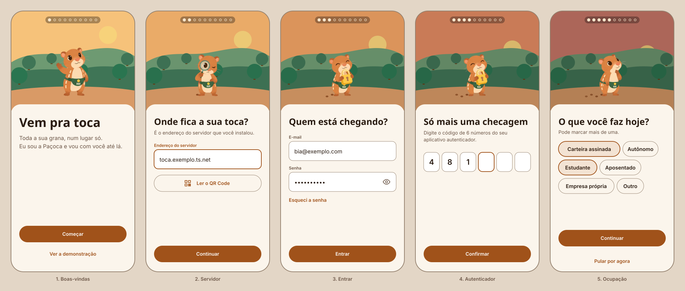
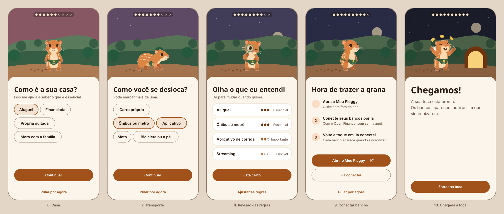
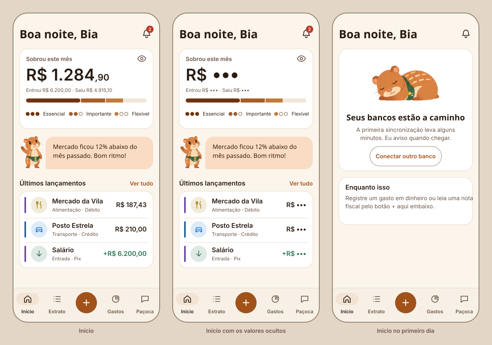
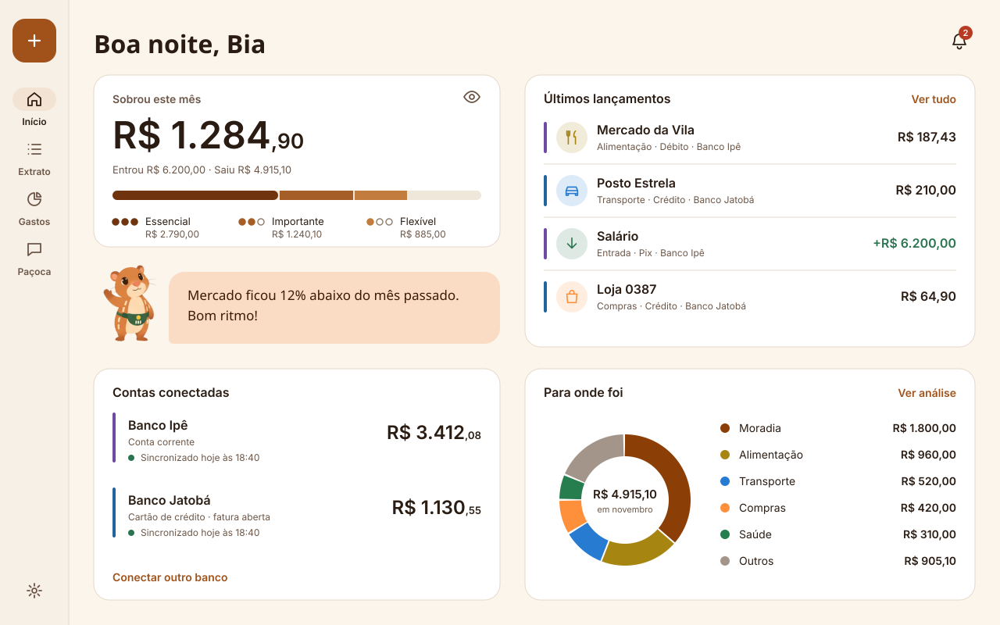

# Parte 6: Telas A, primeiro acesso e Início

O primeiro acesso é a "Trilha até a toca": dez etapas numa caminhada pela mata, do fim de tarde até a noite. A última etapa chega à toca, que é o Início do app.

- **Data:** 2026-11-12
- **Para regenerar:** `node docs/design/telas/gerar-telas-a.mjs`
- **De onde vem cada coisa:** cores e medidas do [`tokens.json`](tokens/tokens.json), componentes da [Parte 5](05-componentes.md) e a Paçoca das 12 poses ilustradas em [`mascote/ilustrada`](mascote/ilustrada).
- **Tamanho das telas:** celular de 360 × 760 e desktop de 1280 × 800.
- **Dados:** fictícios, como em todo o repositório.

## Trilha até a toca

### Etapas 1 a 5

### Etapas 6 a 10

No tema escuro, o cenário é o mesmo e só o cartão muda: [etapas 1 a 5](telas/trilha-1-escuro.svg) e [etapas 6 a 10](telas/trilha-2-escuro.svg).

| Etapa | O que a tela pede | Paçoca | Pode pular? |
|---|---|---|---|
| 1. Boas-vindas | Começar, ou ver a demonstração | Acenando | — |
| 2. Servidor | O endereço do servidor, digitado ou lido por QR Code | Com a lupa | Não |
| 3. Entrar | E-mail e senha | Com o cadeado | Não |
| 4. Autenticador | O código de 6 números | Com o cadeado | Não |
| 5. Ocupação | O que a pessoa faz hoje; pode marcar mais de uma | Pensando | Sim |
| 6. Casa | Como é a moradia | De frente | Sim |
| 7. Transporte | Como a pessoa se desloca; pode marcar mais de uma | Andando | Sim |
| 8. Revisão das regras | Confirmar o que virou Essencial, Importante e Flexível | Com a lupa | Ajusta depois |
| 9. Conectar bancos | Abrir o Meu Pluggy e voltar com "Já conectei" | Em três quartos | Sim |
| 10. Chegada à toca | Entrar no app | Comemorando | — |

### Como a trilha funciona

- **Uma pergunta por tela.** O título é a pergunta, na fonte da marca. As respostas são chips grandes, de 44 de altura.
- **O cenário conta o progresso.** O céu vai do laranja do fim de tarde ao azul da noite, o sol desce, a lua e as estrelas aparecem e as pegadas se acumulam atrás da Paçoca. Na última etapa surge a toca, com a luz acesa.
- **As dez pegadas no alto** repetem o progresso em forma de indicador. O leitor de tela anuncia "Etapa 5 de 10".
- **O que é sério fica no cartão.** Campos, chips e botões ficam num cartão com o fundo do app, iguais ao resto das telas. O cenário nunca passa por trás de um campo.
- **Botão principal sempre no mesmo lugar,** na parte de baixo, ao alcance do polegar. "Pular por agora" fica logo abaixo, nas etapas do guia.
- **Movimento:** ao avançar, o cenário desliza com paralaxe leve e a Paçoca anda um trecho. Com "reduzir movimento" ligado, a tela troca de quadro sem deslizar.
- **Chegada:** a Paçoca comemora com as moedinhas uma única vez, e a tela não cobra nada da pessoa.

### Regras de cada etapa

- **Servidor:** o QR Code é o caminho principal, porque digitar um endereço no celular é o passo mais chato. O campo fica para quem preferir digitar [Proposta: depende de o servidor mostrar o QR Code na instalação].
- **Entrar:** os campos têm as dicas de preenchimento automático, para o gerenciador de senhas funcionar. O erro aparece embaixo do campo, em linguagem simples, e não diz se foi o e-mail ou a senha que falhou.
- **Autenticador:** os seis campos aceitam o código colado de uma vez e avançam sozinhos.
- **Guia (etapas 5 a 7):** a escolha fica marcada com borda e fundo, não só com cor. A Paçoca responde a cada escolha numa frase curta, que vem na [Parte 10](README.md).
- **Revisão das regras:** cada linha mostra a categoria, as pintas e o nome do nível. "Ajustar as regras" abre a edição; "Está certo" segue.
- **Conectar bancos:** a tela avisa que o site abre fora do app. O botão leva o ícone de "abrir fora".
- **Demo:** as etapas 2, 3 e 4 aparecem preenchidas com dados fictícios e bloqueadas, com o botão "Continuar" ([Parte 1](01-revisao-das-decisoes.md), mudança 3).

### O cenário é provisório

O cenário das folhas foi desenhado em código, com morros, árvores e céu em formas simples. Ele define a composição: o que fica em cada camada, onde a Paçoca pisa e quanto o céu escurece por etapa. A arte final vem de uma ilustração em camadas, no mesmo estilo da Paçoca.

| Camada | O que tem | Movimento na paralaxe |
|---|---|---|
| Céu | Cor da hora, sol, lua e estrelas | Parado |
| Morro do fundo | Morro claro e árvores pequenas | Lento |
| Morro do meio | Morro escuro e árvores grandes | Médio |
| Chão | A trilha, as pegadas e a toca | Junto com a Paçoca |

## Início

No tema escuro: [Início no celular](telas/inicio-escuro.svg).

| Bloco | O que mostra | Ao tocar |
|---|---|---|
| Saudação e sino | "Boa noite, Bia" e o contador de alertas | O sino abre os alertas |
| Sobrou este mês | O valor, o que entrou e saiu e a barra por essencialidade | Abre Gastos |
| Fala da Paçoca | Um destaque por vez, em uma frase | Abre o assunto da frase |
| Últimos lançamentos | Os três mais recentes | Abre o lançamento; "Ver tudo" abre o Extrato |

- **Uma pergunta no topo: "quanto sobrou?".** O resto da tela explica esse número.
- **O olho no cartão** esconde todos os valores do app de uma vez. Os valores viram "R$" e três pintas, e a escolha fica guardada.
- **A barra por essencialidade** tem a legenda com as pintas e o nome de cada nível. A parte vazia da barra é o que sobrou.
- **A fala da Paçoca** traz no máximo uma brincadeira e nunca aparece junto de um erro que envolve dinheiro.
- **Puxar para atualizar** sincroniza o app com o servidor. A frase lembra que cada banco se atualiza sozinho, uma vez por dia.

### Estados do Início

| Estado | O que muda |
|---|---|
| Valores ocultos | Todos os valores viram "R$ •••". O leitor de tela diz "valor oculto". |
| Primeiro dia | Sem lançamentos ainda: a Paçoca dorme, a tela explica a espera e aponta o botão "+". |
| Sem internet | Uma faixa no topo avisa, e a tela mostra os últimos dados com a hora da sincronização. |
| Conexão vencendo | A faixa de alerta da [Parte 5](05-componentes.md) entra acima do cartão principal. |
| Carregando | O esqueleto tem a forma dos cartões; a saudação aparece na hora. |

## Início no desktop

No tema escuro: [Início no desktop](telas/inicio-desktop-escuro.svg).

- **O trilho substitui a barra de baixo.** O "+" vai para o topo do trilho e as configurações para o pé.
- **Duas colunas.** À esquerda fica o resumo: o que sobrou, a fala da Paçoca e as contas. À direita ficam os lançamentos e a rosca "Para onde foi".
- **A rosca só aparece a partir de 840 de largura.** No celular, ela mora em Gastos.
- **O conteúdo para de crescer em 1200 de largura** e fica centrado em telas maiores.
- **Teclado:** a ordem do foco segue a leitura: trilho, coluna da esquerda e coluna da direita.

## A conferir

- **Preenchimento automático:** as dicas de e-mail, senha e código de uso único nos campos do Flutter [Conferir: api.flutter.dev, AutofillHints].
- **Leitura de QR Code:** o pacote e as permissões de câmera em cada sistema [Conferir: pub.dev, pacote de leitura de códigos escolhido na Parte 12].
- **Abrir o Meu Pluggy:** abrir o site fora do app e voltar para a mesma etapa [Conferir: pub.dev/packages/url_launcher e docs.pluggy.ai].
- **Paralaxe e "reduzir movimento":** como ler a preferência do sistema no Flutter [Conferir: api.flutter.dev, MediaQuery.disableAnimations].
- **Primeira conta num servidor novo:** a variação "criar conta" da etapa 3 depende do plano ([Parte 1](01-revisao-das-decisoes.md), pendências).

## Próximo

Parte 7: extrato, detalhe do lançamento, correção de categoria e Gastos.
