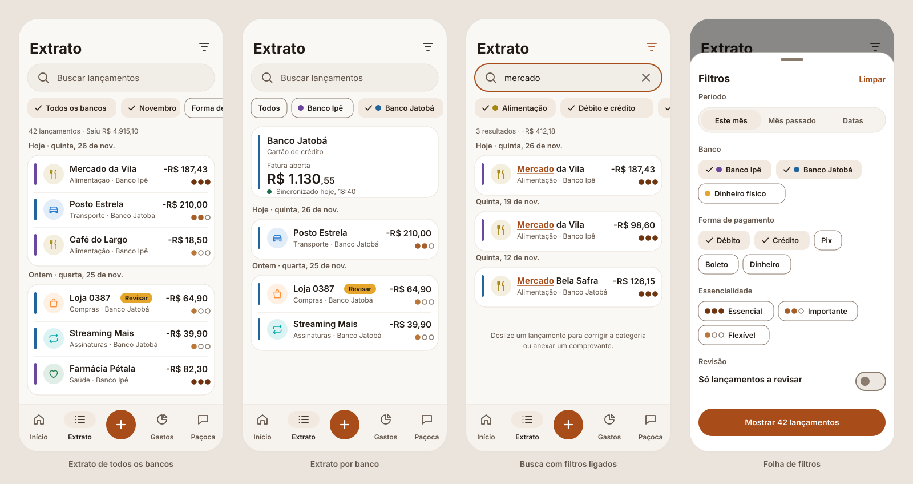
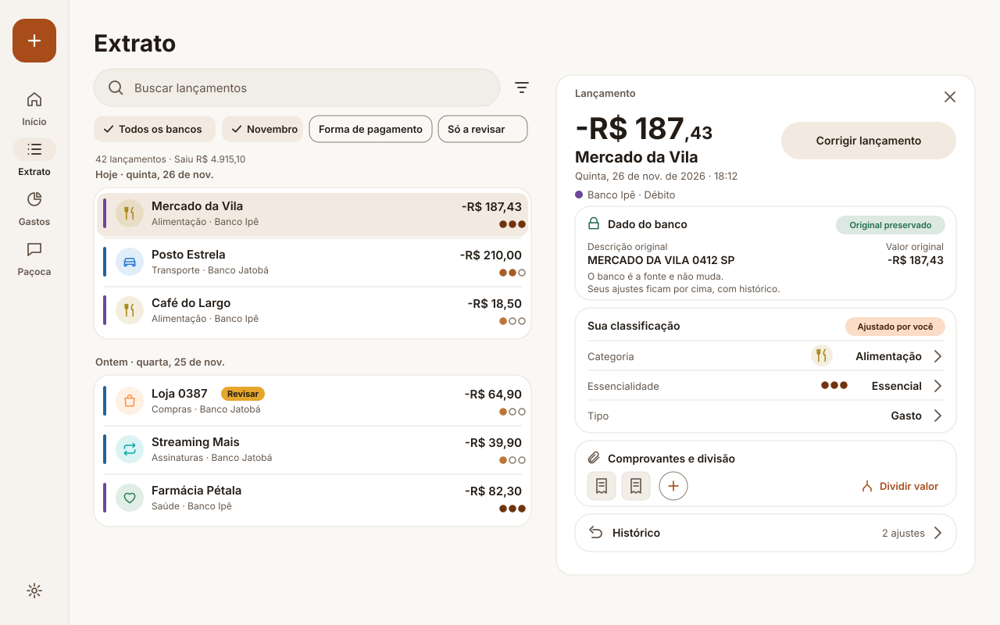
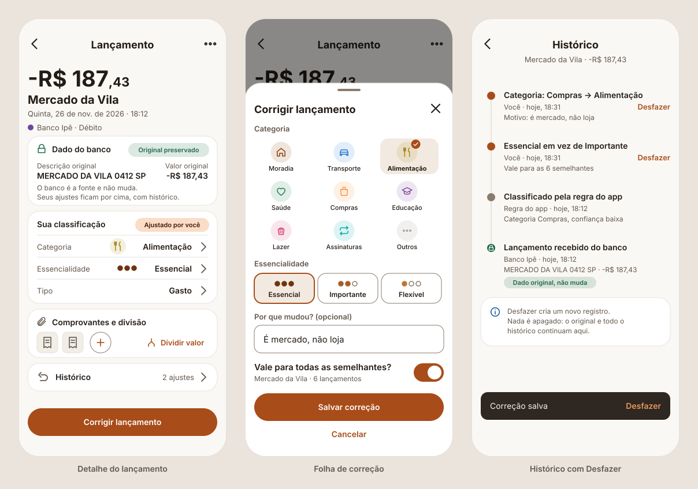
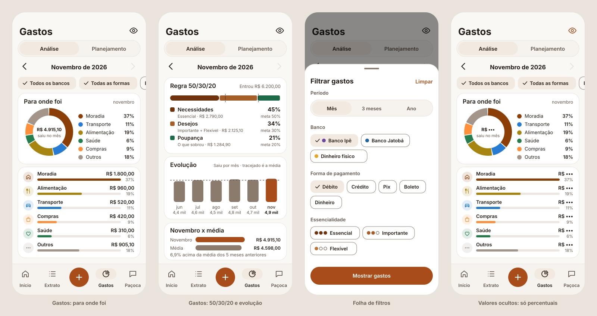
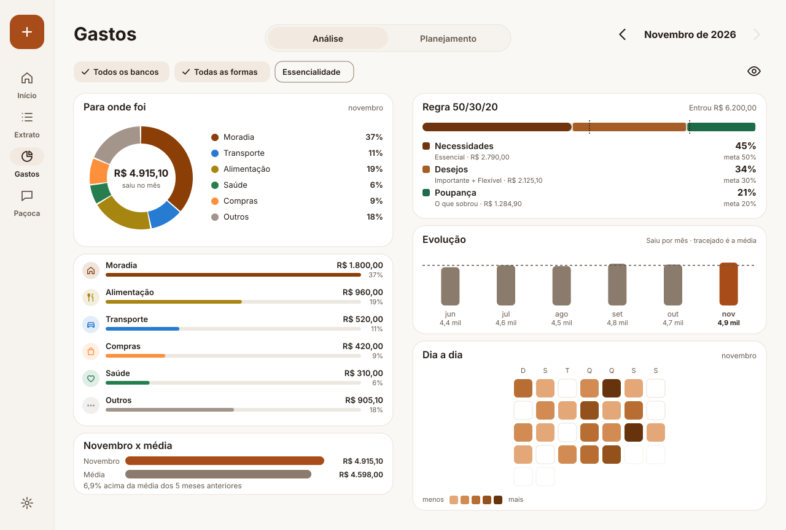

# Parte 7: Telas B, extrato, detalhe, correção e Gastos

As telas da Parte 7 seguem a identidade **Toca Editorial** e respondem a três perguntas: "o que entrou e saiu?" (Extrato), "o que é este lançamento e o que eu mudei nele?" (Detalhe e correção) e "para onde foi o meu dinheiro?" (Gastos).

- **Data:** 2026-11-26
- **Para regenerar:** `node docs/design/telas/gerar-telas-b.mjs`
- **De onde vem cada coisa:** tokens de [`tokens.json`](tokens/tokens.json), componentes da [Parte 5](05-componentes.md), peças comuns do [`kit.mjs`](telas/kit.mjs) e o mesmo conjunto de dados fictícios da [Parte 6](06-telas-a.md): Bia, Banco Ipê (conta corrente) e Banco Jatobá (cartão de crédito).
- **Tamanho das telas:** celular de 360 × 760 e desktop de 1280 × 800 (Gastos usa 1280 × 864, porque tem mais cartões).
- **Fontes nas imagens:** o app usa `Plus Jakarta Sans` e `Inter`. No GitHub, as folhas aparecem com a fonte do sistema, e por isso os textos ficam mais largos do que no app.
- **Dados:** fictícios, como em todo o repositório. Todo valor de saída leva o sinal `-`, e todo número usa algarismos tabulares.

## Extrato

No tema escuro: [Extrato no celular](telas/extrato-escuro.svg).

| Tela | O que mostra | Ao tocar |
|---|---|---|
| **Todos os bancos** | Busca, chips de filtro, total do período e os lançamentos agrupados por dia ("Hoje", "Ontem", depois a data) | Abre o detalhe. Deslizar corrige a categoria ou anexa um comprovante |
| **Por banco** | Uma faixa de chips (Todos, cada banco e Dinheiro físico), o cartão do banco com a fatura aberta e a hora da última sincronização, e só os lançamentos dele | Trocar o chip troca o banco sem sair da tela |
| **Busca com filtros** | O termo buscado grifado nos resultados, os filtros ligados como chips marcados e a contagem com o total ("3 resultados · -R$ 412,18") | Tocar no ✓ de um chip desliga o filtro |
| **Folha de filtros** | Período, banco, forma de pagamento, essencialidade e a chave "Só lançamentos a revisar", com o botão "Mostrar 42 lançamentos" | "Limpar" volta ao padrão: este mês, todos os bancos |

### A linha do extrato

Cada linha lê-se da esquerda para a direita, na ordem em que a pessoa procura as coisas:

| Parte | O que é |
|---|---|
| Faixa de 4 px | Cor do banco, vinda do servidor ([Parte 1](01-revisao-das-decisoes.md), mudança 12). O nome do banco vem escrito na segunda linha, então a cor não é o único sinal |
| Círculo | Ícone da categoria, na cor fixa do grupo |
| Nome | Estabelecimento limpo, em `titleMedium`. Cortado com reticências se não couber |
| **Revisar** | Selo em Milho com texto Cacau, quando a classificação teve pouca confiança. Tocar abre a [folha de correção](#folha-de-correção) |
| Segunda linha | Categoria e banco. A lista usa o nome curto **Assinaturas** para o grupo "Assinaturas e serviços" |
| Valor | Alinhado à direita com `tnum`. Saída em Cacau com `-`, entrada em Mata com `+`. Com os valores ocultos vira "R$ •••" |
| Pintas | ●●● Essencial, ●●○ Importante, ●○○ Flexível, sempre abaixo do valor. O nome do nível vai para o rótulo de acessibilidade |

- **Sem a Paçoca na lista:** a mascote nunca aparece entre lançamentos ([Parte 3](03-mascote.md)). Um extrato vazio usa o `EstadoVazio` da [Parte 5](05-componentes.md) e o texto da [Parte 10](10-microcopy.md).
- **Correção em lote:** segurar uma linha liga o modo de seleção, com caixas de marcar e a barra "Corrigir N lançamentos". O fluxo está na [Parte 9](09-fluxos.md); a tela não tem folha própria, porque reaproveita a [folha de correção](#folha-de-correção).

### Extrato no desktop

No tema escuro: [Extrato no desktop](telas/extrato-desktop-escuro.svg).

- **Lista e detalhe lado a lado** a partir de 840 px ([`tokens.json`](tokens/tokens.json), `layout.expandido.detalheAoLado`). O lançamento selecionado fica com o fundo `secondaryContainer`.
- O botão "Corrigir lançamento" sobe para o cabeçalho do painel, para o conteúdo do detalhe não ser empurrado para baixo.

## Detalhe do lançamento

No tema escuro: [Detalhe, correção e histórico](telas/detalhe-escuro.svg).

| Bloco | O que mostra | Regra |
|---|---|---|
| Valor e estabelecimento | Valor em 38 px com centavos menores, nome, data com hora e banco com a forma de pagamento | O valor nunca é cortado |
| **Dado do banco** | Descrição e valor exatamente como o banco mandou, com o selo "Original preservado" e o cadeado | Não tem botão de editar. O dado do provedor é só de inclusão ([ADR-012](../adr/0012-dado-do-provedor-append-only-e-camada-de-ajustes.md)) |
| **Sua classificação** | Categoria, essencialidade e tipo (Gasto, Entrada, Transferência...), cada um com um `>` para abrir a correção | O selo "Ajustado por você" aparece quando há ajuste. Sem ajuste, o bloco mostra o que as regras decidiram |
| Comprovantes e divisão | Miniaturas, "+" para anexar e "Dividir valor" | Dividir abre a divisão em partes da [Parte 8](08-telas-c.md) |
| Histórico | Quantos ajustes existem | Abre a [linha do tempo](#histórico-com-desfazer) |

- **O menu `⋯` do topo** guarda as ações raras: marcar como atípico (sai das projeções), adicionar etiqueta e copiar a descrição original.
- **Um verbo no botão:** "Corrigir lançamento" é a ação principal da tela. É o único botão cheio.

## Folha de correção

É a segunda tela da folha acima: a folha inferior sobe sobre o detalhe, com raio de 28 e fundo escurecido por trás.

| Campo | Como funciona |
|---|---|
| Categoria | Grade de 3 colunas com os 9 grupos. O escolhido ganha fundo `secondaryContainer` e o ✓ no canto, além da cor |
| Essencialidade | Três opções lado a lado, cada uma com as pintas e o nome. A escala é de Caramelo, nunca de semáforo |
| Por que mudou? | Campo de texto opcional. Aparece no histórico como "Motivo" |
| Vale para todas as semelhantes? | Chave. Com ela ligada, a correção vira uma regra para o mesmo estabelecimento e diz quantos lançamentos do mês serão afetados ("6 lançamentos") |
| Salvar correção | Botão principal. Salvar solta uma vibração leve e um aviso rápido com "Desfazer" |
| Cancelar | Botão de texto. Fechar a folha com algo digitado pede confirmação |

## Histórico com Desfazer

A terceira tela da folha mostra a linha do tempo do lançamento, do mais novo para o mais antigo.

| Marca | Quem | Exemplo |
|---|---|---|
| Ponto Terracota | Você | "Categoria: Compras → Alimentação", com o motivo e o botão **Desfazer** |
| Ponto Terracota | Você | "Essencial em vez de Importante", com a nota "Vale para as 6 semelhantes" |
| Ponto cinza | Regra do app | "Classificado pela regra do app", com a confiança baixa que gerou o selo "Revisar" |
| Ponto Mata com cadeado | Banco | "Lançamento recebido do banco", com o selo "Dado original, não muda" |

- **Desfazer não apaga:** cria um registro novo que aponta para o ajuste desfeito ([ADR-012](../adr/0012-dado-do-provedor-append-only-e-camada-de-ajustes.md)). A tela diz isso num cartão informativo, para ninguém achar que perdeu o histórico.
- **Aviso rápido:** depois de salvar, o `SnackBar` "Correção salva" fica 4 segundos com "Desfazer". Ele não carrega erro: erro vai na própria tela.

## Gastos

No tema escuro: [Gastos no celular](telas/gastos-escuro.svg).

Gastos tem duas abas, **Análise** (esta parte) e **Planejamento** ([Parte 8](08-telas-c.md)). O seletor de mês e os filtros ficam sempre no alto.

| Bloco | O que mostra | Ao tocar |
|---|---|---|
| **Para onde foi** | Rosca com o total no centro e a legenda com o nome e o percentual de cada grupo. Até 5 categorias mais Outros, na ordem fixa de `ordemDaRosca`, com 2 px entre as fatias | Uma fatia abre os lançamentos da categoria |
| Ranking | Uma barra por categoria, do maior para o menor, com ícone, valor e percentual. Outros fica por último | Uma barra abre os lançamentos da categoria |
| **Regra 50/30/20** | Barra empilhada com Necessidades (Essencial), Desejos (Importante mais Flexível) e Poupança (o que sobrou do mês), com o percentual e a meta de cada um | Abre o Extrato filtrado pelo grupo |
| Evolução | Barras dos últimos 6 meses, com o mês atual em Terracota e a média dos 5 anteriores em linha tracejada | Uma barra troca o mês da tela |
| Novembro x média | Duas barras e uma frase: "6,9% acima da média dos 5 meses anteriores" | — |
| Dia a dia | Mapa de calor do mês, em um matiz só de Caramelo. Dia sem gasto é célula vazia com borda; dia que ainda não chegou fica apagado | Um dia abre os lançamentos dele |

- **A cor segue a categoria,** nunca a posição no ranking ([Parte 2](02-design-tokens.md)). Manga, Igarapé e Outros ficam abaixo de 3:1 contra a Superfície, por isso a rosca sempre vem com a legenda e o ranking com os nomes.
- **Sem julgamento nos números:** a regra 50/30/20 mostra a meta ao lado do valor, sem cor de acerto ou erro, e "acima da média" é uma constatação, não um alerta.
- **Percentuais que fecham 100:** os valores arredondados usam o método do maior resto. Moradia 37%, Alimentação 19%, Transporte 11%, Compras 9%, Saúde 6% e Outros 18%.
- **O olho do topo** esconde os valores em todo o app. Os gráficos passam a mostrar só percentuais, como na quarta tela da folha.

### Filtros e valores ocultos

- **Folha de filtros:** período (Mês, 3 meses e Ano, uma escolha por vez), banco, forma de pagamento e essencialidade. Os chips selecionados ganham ✓ e fundo `secondaryContainer`, e o botão principal diz quantos gastos aparecem.
- **Valores ocultos:** o centro da rosca e o ranking viram "R$ •••". Os percentuais continuam, e o leitor de tela diz "valor oculto" no lugar do número.

### Gastos no desktop

No tema escuro: [Gastos no desktop](telas/gastos-desktop-escuro.svg).

- **Duas colunas** a partir de 840 px, com largura máxima de 1200 px. A coluna da esquerda responde "para onde foi" (rosca, ranking e comparação com a média), e a da direita responde "como estou indo" (50/30/20, evolução e mapa de calor).
- As abas e o seletor de mês sobem para o cabeçalho da página.

## Estados

| Tela | Estado | O que muda |
|---|---|---|
| Extrato | Carregando | Esqueleto com a forma das linhas, que pulsa a cada 1 segundo. Com "reduzir movimento", fica parado |
| Extrato | Sem resultados | `EstadoVazio` com a frase da [Parte 10](10-microcopy.md) e a ação "Limpar filtros" |
| Extrato | Primeiro dia | `EstadoVazio` da Parte 6: bancos a caminho, sem lançamentos |
| Extrato | Sem internet (modo servidor) | Faixa discreta com a última sincronização, e a lista continua legível |
| Extrato | Valores ocultos | Todos os valores viram "R$ •••". A busca por valor fica desligada |
| Detalhe | Sem ajuste | O selo "Ajustado por você" some e o histórico mostra só a origem |
| Detalhe | Dividido em partes | Cada parte aparece como uma linha com categoria e valor, e a soma tem de fechar com o original |
| Correção | Erro ao salvar | A frase fica na folha, perto do botão, sem piada, e a correção digitada é mantida |
| Gastos | Sem gastos no mês | `EstadoVazio` com a Paçoca dormindo e a ação "Ver outro mês" |
| Gastos | Menos de 2 meses de histórico | A evolução mostra só os meses que existem, e o cartão de média diz "Ainda faltam meses para comparar" |

## A conferir

- **Deslizar para corrigir:** os gestos de deslizar e segurar são decisão desta parte [Suposição]. Conferir o conflito com o gesto de voltar do Android e do iOS [Conferir: Material 3, Swipe; Apple Human Interface Guidelines, Gestures].
- **Mapa de calor:** o widget é próprio ([Parte 1](01-revisao-das-decisoes.md), mudança 16). A célula de 30 px fica abaixo do alvo de 48 dp, então no app a célula tem área de toque ampliada e o rótulo de acessibilidade diz o dia e o valor.
- **Dado original:** o selo "Original preservado" depende de a API devolver a descrição e o valor da última versão do provedor, não só a classificação [Suposição: campos de `banking.transaction_effective`, ADR-012].

## Próximo

[Parte 8](08-telas-c.md): chat com a Paçoca, nota fiscal, gasto em dinheiro, planejamento, alertas, configurações e modo demo.
