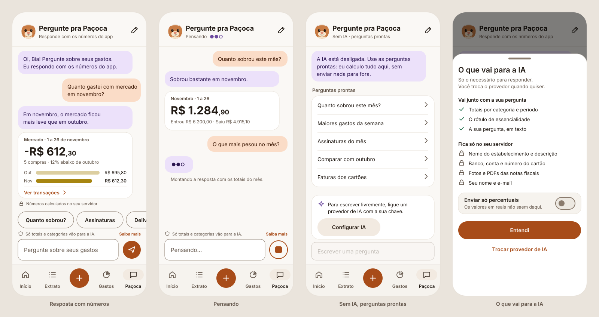
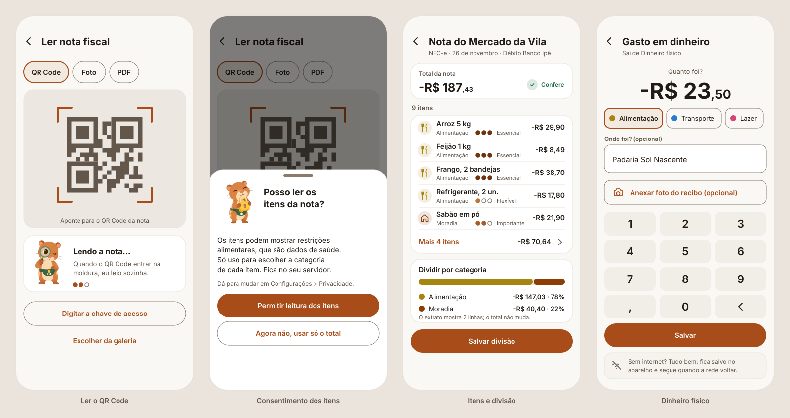
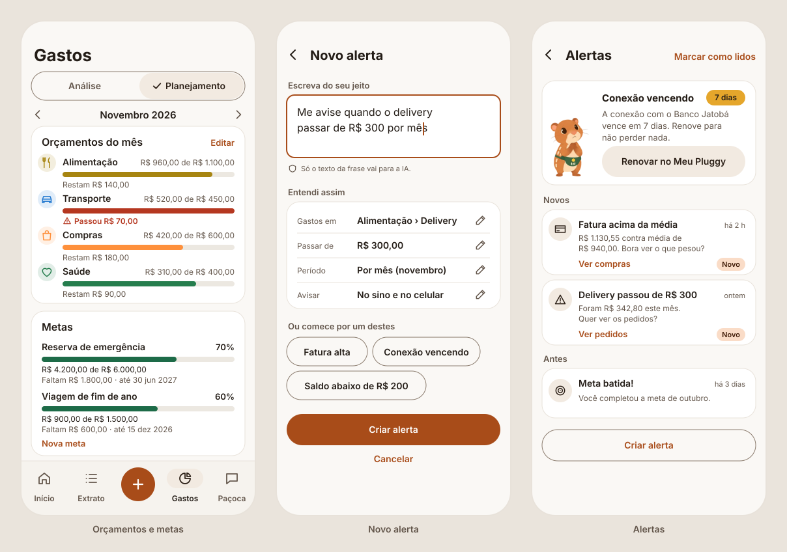
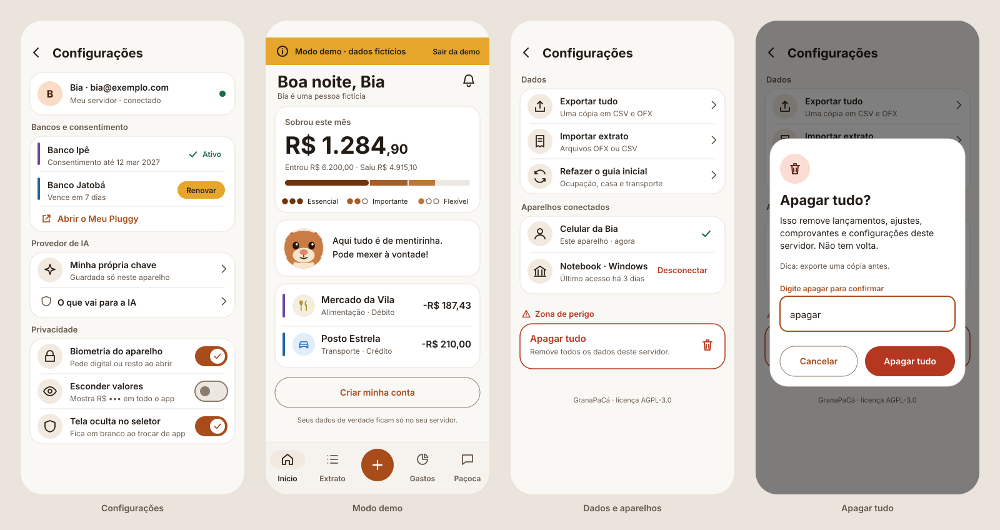

# Parte 8: Telas C, chat, nota fiscal, dinheiro físico, planejamento, alertas, configurações e modo demo

As telas da Parte 8 completam o app no celular: a conversa com a Paçoca, a leitura de nota fiscal, o gasto em dinheiro, o planejamento, os alertas, as configurações e o modo demo. Seguem a identidade **Toca Editorial**, como as [Partes 6](06-telas-a.md) e 7: cartões de borda fina, números tabulares e a Paçoca **no máximo uma vez por tela**.

- **Data:** 2026-11-26
- **Para regenerar:** `node docs/design/telas/gerar-telas-c.mjs`
- **De onde vem cada coisa:** cores, fontes e medidas de [`tokens.json`](tokens/tokens.json); componentes da [Parte 5](05-componentes.md); poses da Paçoca do [`kit.mjs`](telas/kit.mjs), que lê o `pacoca-mini.json` da [Parte 3](03-mascote.md).
- **Tamanho das telas:** celular de 360 × 760. Cada folha mostra de 3 a 4 telas lado a lado.
- **Fontes nas imagens:** o app usa `Plus Jakarta Sans` e `Inter`. No GitHub, as folhas aparecem com a fonte do sistema, porque um SVG não carrega fontes de fora.
- **Dados:** fictícios, como em todo o repositório. Bia, Banco Ipê, Banco Jatobá e os mesmos totais do Início da Parte 6 (sobrou R$ 1.284,90; entrou R$ 6.200,00; saiu R$ 4.915,10).

| Folha | Telas | Arquivos |
|---|---|---|
| Chat | Resposta com números, pensando, sem IA e o que vai para a IA | `chat-claro.svg`, `chat-escuro.svg` |
| Nota fiscal e dinheiro | Ler o QR Code, consentimento dos itens, itens e divisão, dinheiro físico | `comprovantes-claro.svg`, `comprovantes-escuro.svg` |
| Planejamento e alertas | Orçamentos e metas, novo alerta, alertas | `planejamento-claro.svg`, `planejamento-escuro.svg` |
| Configurações e demo | Configurações, modo demo, dados e aparelhos, apagar tudo | `config-claro.svg`, `config-escuro.svg` |

## Chat "Pergunte pra Paçoca"

No tema escuro: [chat com a Paçoca](telas/chat-escuro.svg).

| Bloco | O que mostra | Ao tocar |
|---|---|---|
| Cabeçalho | Retrato da Paçoca (só a cabeça, 40 px), título em `Plus Jakarta Sans` e uma linha de estado | O lápis começa uma conversa nova |
| Balões | A pessoa em `primaryContainer` e a Paçoca em `tertiaryContainer` (Jabuticaba, a cor do chat e da IA) | Segurar copia o texto |
| Cartão de resposta | Período, valor com o sinal `-`, comparação com o mês anterior e o link **Ver transações** | Abre o Extrato já filtrado pela pergunta |
| Nota de origem | "Números calculados no seu servidor", com cadeado | — |
| Sugestões | Chips de perguntas (`Quanto sobrou?`, `Assinaturas`, `Delivery`), com rolagem lateral | Envia a pergunta |
| Aviso de minimização | "Só totais e categorias vão para a IA." e o link **Saiba mais** | Abre a folha "O que vai para a IA" |

**Regra de ouro das respostas:** todo número vem acompanhado do período e de um caminho até as transações que o formaram. Resposta sem número verificável não ganha cartão. [Suposição: os valores do cartão são calculados pelo servidor e a IA só escreve a frase em volta. Isso depende do desenho do chat no plano.]

### Estados do chat

| Estado | O que muda |
|---|---|
| Pensando | As três pintas pulsam num balão, a linha de estado diz "Pensando" e o botão de enviar vira **Parar**. A Paçoca pensando é o próprio retrato do cabeçalho: pose `pensando` do Rive (`estado` 3), sem segundo desenho. |
| Sem IA | Sem provedor ligado, a conversa só tem as **perguntas prontas**, calculadas no servidor. O campo de texto fica desabilitado, com 38% de opacidade, e o cartão "Para escrever livremente, ligue um provedor de IA com a sua chave" leva a **Configurar IA**. |
| Valores ocultos | Os cartões mostram "R$ •••" e a IA só recebe percentuais. |
| Sem internet | O chat com IA fica indisponível e a pessoa vê as perguntas prontas, que não dependem da rede no modo local. |

### O que vai para a IA

Dá para abrir a folha a qualquer momento por **Saiba mais**, pelas configurações ou antes de ligar um provedor.

| Vai junto com a pergunta | Fica só no servidor |
|---|---|
| Totais por categoria e período | Nome do estabelecimento e descrição |
| O rótulo de essencialidade (`Essencial`, `Importante` ou `Flexível`) | Banco, conta e número do cartão |
| A pergunta, em texto | Fotos e PDFs das notas fiscais |
| — | Nome e e-mail |

- **Enviar só percentuais:** chave que, ligada, tira também os valores em reais. É o mesmo princípio do modo "valor oculto".
- **Provedor próprio:** a pessoa traz a própria chave de API, guardada só no aparelho ([Parte 1](01-revisao-das-decisoes.md), mudança 17).
- **Tom:** a folha diz o que acontece, sem alarme e sem jargão.

## Nota fiscal, divisão e dinheiro físico

No tema escuro: [nota fiscal e gasto em dinheiro](telas/comprovantes-escuro.svg).

| Tela | O que pede | Destaque |
|---|---|---|
| **Ler o QR Code** | Apontar a câmera para o QR Code da NFC-e, ou trocar para **Foto** e **PDF** | Moldura em Terracota, a Paçoca com lupa lendo e **Digitar a chave de acesso** como saída |
| **Consentimento dos itens** | Permitir ou não a leitura dos itens. Aparece só na primeira nota. | Os itens podem revelar restrições alimentares, que são dados de saúde. Quem recusa continua com o total da nota. |
| **Itens e divisão** | Conferir a categoria e a essencialidade de cada item e salvar a divisão | Total da nota com selo "Confere", itens com pintas e nome do nível, barra de divisão por categoria |
| **Dinheiro físico** | Valor, categoria e, se quiser, o local e uma foto | Teclado numérico grande, chips das categorias recentes e aviso de que funciona sem internet |

- **A Paçoca na leitura:** com lupa, sobre a superfície e nunca sobre a imagem da câmera, que é como uma foto ([Parte 3](03-mascote.md)).
- **Divisão:** cada parte vira uma linha no extrato, e a soma continua igual ao valor do banco. No exemplo, a nota de R$ 187,43 vira R$ 147,03 em Alimentação e R$ 40,40 em Moradia. O dado original do banco não muda: a divisão é um ajuste, como em [ADR-012](../adr/0012-dado-do-provedor-append-only-e-camada-de-ajustes.md).
- **Itens com pouca confiança** ganham o selo **Revisar** e entram na fila "A revisar" da [Parte 7](07-telas-b.md).
- **Dinheiro físico:** salva em dois toques (valor e **Salvar**), funciona sem internet e fica na seção **Dinheiro físico**, ao lado das contas dos bancos.

### Estados

| Estado | O que muda |
|---|---|
| Leitura que falha | A moldura fica parada, a Paçoca continua com a lupa e a frase diz o que fazer: "Não consegui ler. Chegue um pouco mais perto ou digite a chave." |
| Nota repetida | "Essa nota já está no seu extrato." com o link para o lançamento. Nada é gravado duas vezes. |
| Consentimento recusado | O app usa só o total da nota, sem itens, e **Configurações > Privacidade** deixa mudar de ideia. |
| Dinheiro sem internet | O lançamento fica salvo no aparelho e vai para o servidor quando a rede voltar. |

## Planejamento e alertas

No tema escuro: [planejamento e alertas](telas/planejamento-escuro.svg).

| Tela | O que mostra | Ao tocar |
|---|---|---|
| **Gastos, aba Planejamento** | Seletor de mês, **Orçamentos do mês** (uma barra por categoria, com o número ao lado) e **Metas** com quanto falta e o prazo | **Editar** muda os limites, **Nova meta** abre o cadastro |
| **Novo alerta** | Campo de texto livre, a **interpretação em quatro linhas** (o que, quanto, período e canal) e atalhos | Cada linha tem o lápis para ajustar. **Criar alerta** salva. |
| **Alertas** | Faixa fixa de conexão vencendo, depois **Novos** e **Antes** | Cada alerta tem a sua ação: **Ver compras**, **Ver pedidos** |

- **Orçamento estourado:** a barra vira Urucum **e** ganha o ícone de alerta com a frase "Passou R$ 70,00". Nunca só a cor, e nunca com vergonha.
- **Barras com número:** o `LinearProgressIndicator` sempre vem com o valor gasto, o limite e o que resta ([Parte 5](05-componentes.md)).
- **Alerta em linguagem natural:** a pessoa escreve "Me avise quando o delivery passar de R$ 300 por mês" e o app mostra como entendeu, para ela corrigir antes de criar. Só o texto da frase vai para a IA.
- **Conexão vencendo:** é a `FaixaDeAlerta`, que não some até a pessoa renovar. A Paçoca preocupada, sem drama, é o único desenho da tela. O contador do sino da Parte 6 conta só os alertas novos (aqui, 2).
- **Metas:** a barra usa Mata, que é a cor de valor positivo. A frase diz quanto falta e até quando.

### Estados

| Estado | O que muda |
|---|---|
| Sem orçamento | Estado vazio com a Paçoca e o botão **Criar o primeiro orçamento**. |
| Sem alertas | "Tudo calmo por aqui." e o atalho **Criar alerta**. |
| Interpretação errada | A pessoa toca no lápis da linha. Se a IA estiver desligada, o app pede os campos um a um. |
| Valores ocultos | Os valores viram "R$ •••" e as barras mostram só o percentual. |

## Configurações e modo demo

No tema escuro: [configurações e modo demo](telas/config-escuro.svg).

| Tela | O que mostra | Ao tocar |
|---|---|---|
| **Configurações** | Conta, **Bancos e consentimento**, **Provedor de IA** e **Privacidade** (biometria, esconder valores e tela oculta no seletor de apps) | As chaves salvam na hora, sem botão |
| **Modo demo** | Faixa fixa **Modo demo · dados fictícios** no topo do Início e uma pessoa fictícia (Bia) | **Sair da demo** volta para a escolha de modo. **Criar minha conta** abre o primeiro acesso. |
| **Dados e aparelhos** | Exportar tudo, importar extrato, refazer o guia inicial, aparelhos conectados e a **Zona de perigo** | **Desconectar** encerra a sessão do aparelho |
| **Apagar tudo** | Diálogo de confirmação destrutiva | Só habilita o botão depois de digitar "apagar" |

- **Consentimento do banco:** cada conexão mostra até quando vale. O estado vem em palavras e em ícone ("Ativo" com visto, "Vence em 7 dias" com o selo **Renovar** em Milho, sempre com texto escuro por cima).
- **Faixa do modo demo:** Milho com `sobreMilho` (7,86:1 no tema claro e 10,22:1 no escuro; o par está no `check-contrast.mjs`). Fica sobre todas as telas da demo e nunca pode ser dispensada. Na demo, nada é salvo, e o Início ganha a fala da Paçoca "Aqui tudo é de mentirinha".
- **Zona de perigo:** contorno em Urucum e o ícone de alerta. A ação destrutiva só existe dentro do diálogo.
- **Diálogo:** o título é a pergunta ("Apagar tudo?"), o texto diz o que some e que não tem volta, e a dica sugere exportar antes. Os botões são verbos: **Cancelar** e **Apagar tudo**, este em Urucum como único botão preenchido ([Parte 5](05-componentes.md)).
- **Sessões por aparelho:** o aparelho atual vem com o visto e não pode ser desconectado dali.
- **Apagar tudo no servidor:** é o único caminho que libera a remoção das tabelas append-only (ADR-012).

### Estados

| Estado | O que muda |
|---|---|
| Modo local no celular | Sem servidor: a seção de bancos mostra só importação de arquivos e **Aparelhos conectados** some. [Suposição] |
| Chave de IA inválida | O cartão do provedor mostra a frase de erro e o botão **Trocar a chave**. O app segue funcionando sem IA. |
| Biometria indisponível | A chave fica desligada, com a frase "Este aparelho não tem biometria cadastrada." |
| Exportação em andamento | Aviso rápido "Preparando a sua cópia…" e, no fim, **Compartilhar**. |

## Regras que valem para as quatro folhas

- Rótulos de essencialidade **sem julgamento**: `Essencial`, `Importante` e `Flexível`, com as pintas ●●●, ●●○ e ●○○.
- **Saídas sempre com o sinal `-`** (`-R$ 187,43`). Entradas em Mata, com `+`.
- A Paçoca aparece no máximo uma vez por tela e nunca em lista de lançamentos.
- No máximo uma brincadeira por tela, e nenhuma em erro que envolve dinheiro. Na Parte 8, a única fala de brincadeira que a Paçoca tem é a do Início da demo.
- Cor nunca é o único sinal: orçamento estourado, conexão vencendo e consentimento têm texto e ícone.
- Alvos de toque de 48 × 48, mesmo quando o desenho é menor (chips de 40, teclas do teclado numérico, chaves de 32).

## A conferir

- **Câmera e QR Code:** pacote de leitura de QR Code no Flutter e permissões de câmera no Android e no iOS [Conferir: pub.dev/packages/mobile_scanner].
- **Leitura da NFC-e:** o QR Code traz a chave de acesso e o endereço da consulta pública, que muda de estado para estado [Conferir: portal da NFC-e de cada estado].
- **Chave de IA:** onde guardar a chave com segurança em cada plataforma [Conferir: pub.dev/packages/flutter_secure_storage].
- **Sessões por aparelho:** depende de como o backend identifica o aparelho [Suposição: um token por aparelho].

## Próximo

[Parte 9](09-fluxos.md): fluxos ponta a ponta, do primeiro acesso ao chat.
