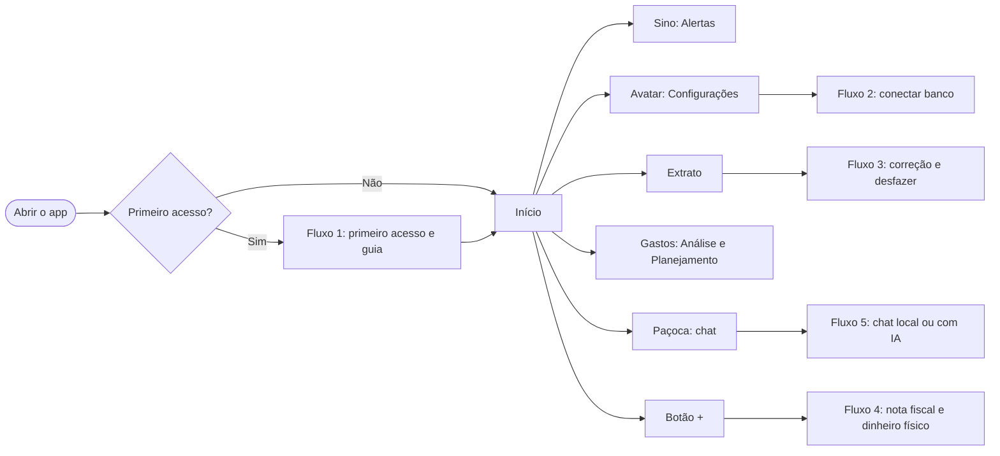
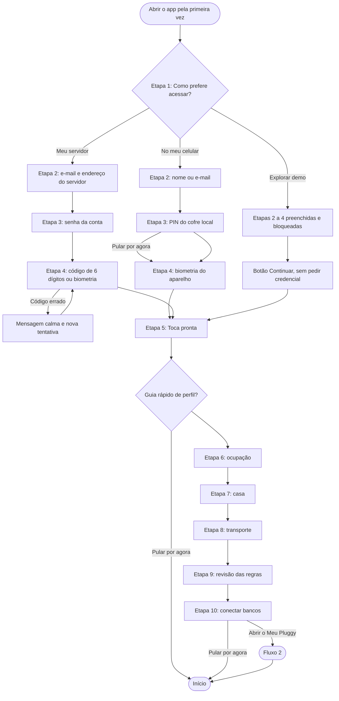
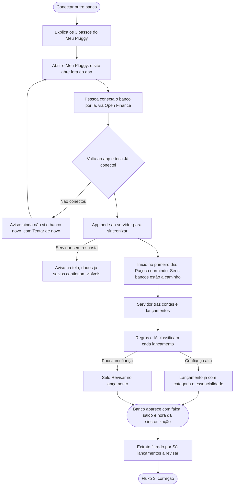
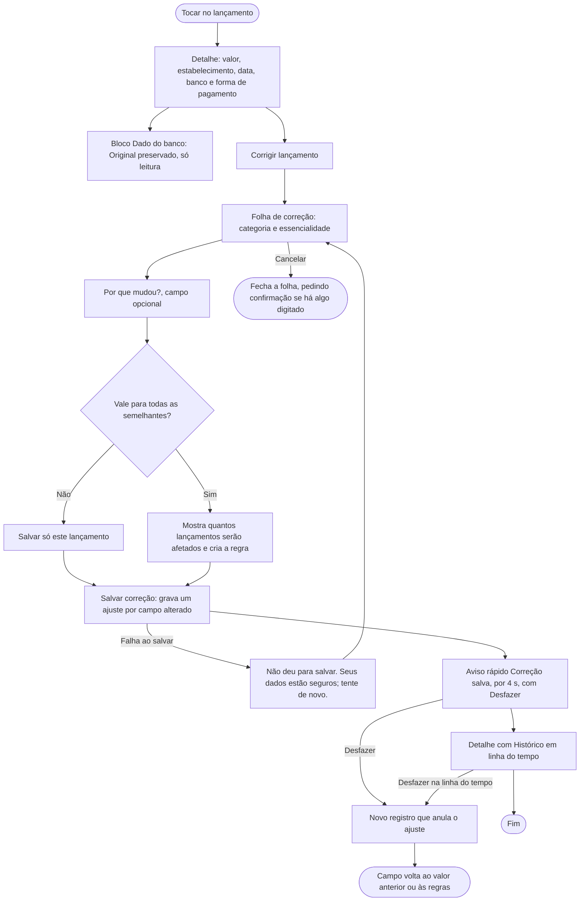
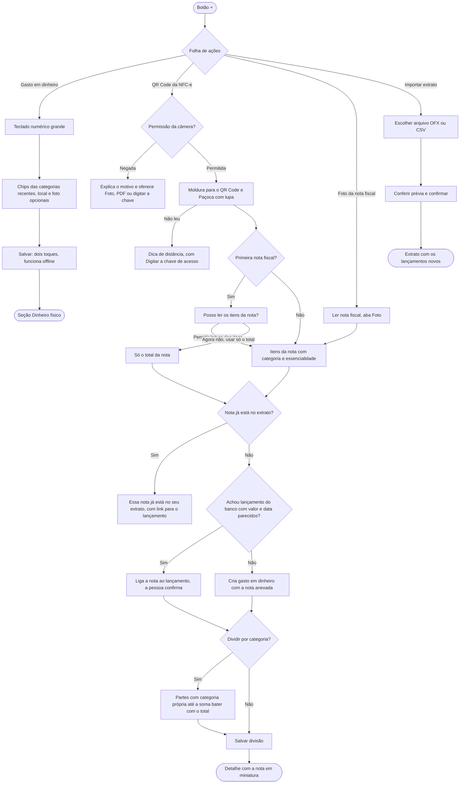
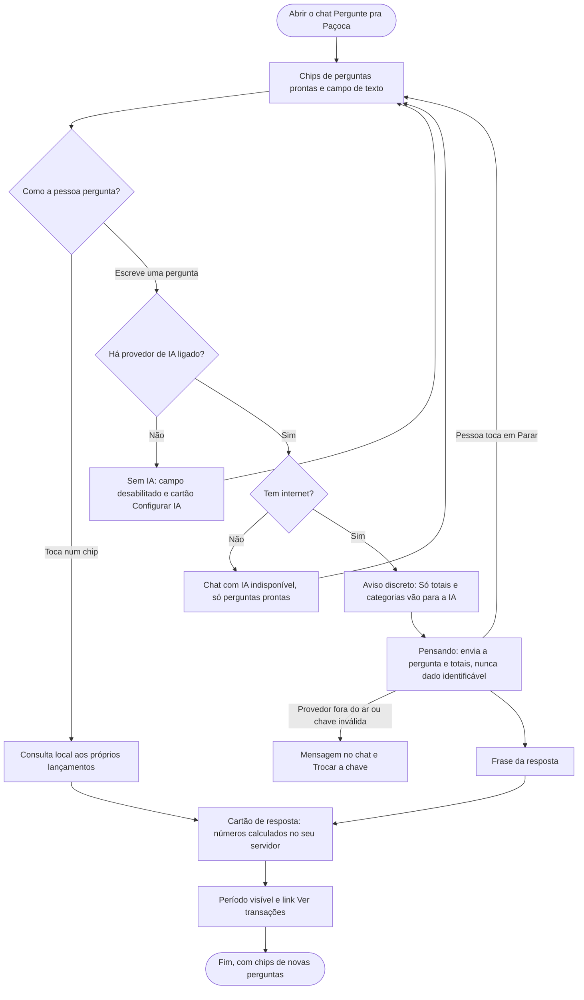

# Parte 9: Fluxos

Os caminhos que ligam as telas das Partes [6](06-telas-a.md), [7](07-telas-b.md) e [8](08-telas-c.md), de ponta a ponta. Cada fluxo diz o que dispara, o que a pessoa faz em cada passo, o que acontece quando algo dá errado e onde termina.

- **Data:** 2026-11-26
- **Para regenerar:** não há gerador. Esta parte é só texto, e os diagramas são Mermaid, que o GitHub desenha sozinho.
- **De onde vem cada coisa:** telas e nomes das Partes 6 a 8, textos da [Parte 10](10-microcopy.md), regras de dado da [ADR-012](../adr/0012-dado-do-provedor-append-only-e-camada-de-ajustes.md) e decisões da [Parte 1](01-revisao-das-decisoes.md).
- **Marcas:** [Suposição] é decisão tomada aqui sem confirmação. [Conferir: fonte] é fato externo a validar antes de implementar.
- **Dados:** fictícios, como em todo o repositório. A pessoa dos exemplos é a Bia, e os bancos são o Banco Ipê e o Banco Jatobá.

## Regras que valem para todos os fluxos

| Regra | O que significa na prática |
|---|---|
| Uma pergunta por tela | Cada passo responde a uma dúvida e tem uma ação principal. |
| Nada trava a pessoa | Todo passo opcional tem "Pular por agora" ou "Agora não", e voltar nunca perde o que foi digitado. |
| Dinheiro nunca se perde em silêncio | O dado original do banco não muda. Correção é um registro novo, e dá para desfazer (ADR-012). |
| Erro diz o que fazer | A mensagem fala o que aconteceu, que os dados estão seguros e qual é o próximo passo. Sem piada quando envolve dinheiro. |
| Funciona sem rede onde dá | Gasto em dinheiro, correção no modo local e as perguntas prontas do chat não dependem de internet. |
| A Paçoca aparece uma vez por tela | Ela ajuda e nunca atrapalha a leitura dos números ([Parte 3](03-mascote.md)). |
| Reduzir movimento | Com `MediaQuery.disableAnimations` ligado, cada fluxo troca a animação pelo quadro parado, com fade de 150 ms. |

## Mapa do app

Todos os fluxos partem de um destes pontos. O "+" é uma ação e nunca fica selecionado ([Parte 1](01-revisao-das-decisoes.md), mudança 10).

## Fluxo 1: primeiro acesso, três modos e guia

- **Gatilho:** abrir o app sem nenhuma conta neste aparelho.
- **Telas:** [Parte 6](06-telas-a.md), etapas 1 a 10.
- **Final:** Início, vazio no primeiro dia ou já com dados.

| Passo | O que a pessoa faz | O que o app faz | Se algo der errado |
|---|---|---|---|
| 1. Modo | Escolhe *No meu celular*, *Meu servidor* ou *Explorar demo*. | A Paçoca olha para a opção escolhida. O modo vira o padrão do aparelho. | Sem erro possível: uma opção vem marcada. |
| 2. E-mail | Digita nome ou e-mail. No modo servidor, também o endereço do servidor. | Os campos têm dicas de preenchimento automático, para o gerenciador de senhas funcionar. | Endereço sem resposta: "Não achei esse servidor. Confira o endereço e tente de novo." O erro aparece ao sair do campo, não a cada tecla. |
| 3. Senha ou PIN | Cria a senha do servidor ou o PIN do cofre local. | A Paçoca tampa os olhos, e o olho do campo dá uma espiadinha. | Senha curta ou fraca: a frase diz como melhorar. No modo local sem trava, a etapa pode ser pulada. |
| 4. Segurança | Digita o código do autenticador ou ativa a biometria. | O escudo acende uma pinta a cada dígito certo. | Código errado: balanço calmo de cabeça (`erroCalmo`) e texto sem drama. Biometria recusada: oferece o PIN. |
| 5. Toca pronta | Toca em "Entrar na toca". | Pulinho comemorativo com três pintas-moedinhas. | — |
| 6 a 9. Guia | Marca chips de ocupação, casa e transporte e confere as regras. | Gera as regras iniciais de essencialidade. | Cada tela tem "Pular por agora". Quem pula fica com as regras padrão e pode refazer o guia em Configurações, "Refazer o guia inicial". |
| 10. Conectar bancos | Segue os três passos do Meu Pluggy ou importa OFX/CSV. | Abre o site fora do app. | Ver o [Fluxo 2](#fluxo-2-conectar-banco-sincronizar-e-revisar). |

**Diferenças entre os modos:**

| | No meu celular | Meu servidor | Explorar demo |
|---|---|---|---|
| Onde ficam os dados | Cofre criptografado no aparelho | No servidor da pessoa | Dados fictícios da Bia, sem salvar nada |
| Credencial | PIN opcional | Senha mais código de 6 dígitos ou biometria | Nenhuma: as etapas aparecem preenchidas e bloqueadas |
| Internet | Funciona 100% offline | Precisa para sincronizar. Sem ela, mostra o que já veio | Precisa só para carregar a página |
| Conectar banco | Só importação de OFX/CSV: em Configurações, a seção de bancos mostra só a importação e "Aparelhos conectados" some ([Parte 8](08-telas-c.md)) [Suposição] | Meu Pluggy e importação | Simulado: os bancos já vêm conectados |
| Faixa fixa | — | Última sincronização, quando está sem rede | "Modo demo · dados fictícios", que não dá para dispensar |

Na demo, o guia vale de verdade, e a revisão mostra as regras que o perfil geraria [Suposição: aplicar as regras do guia aos dados da demo depende do ADR-008]. **Sair da demo** volta para a escolha de modo, e **Criar minha conta** abre o primeiro acesso.

## Fluxo 2: conectar banco, sincronizar e revisar

- **Gatilho:** etapa 10 do guia, "Conectar outro banco" no Início, ou Configurações, "Bancos e consentimento".
- **Telas:** [Parte 6](06-telas-a.md) (etapa 10 e Início no primeiro dia), [Parte 7](07-telas-b.md) (Extrato e correção) e [Parte 8](08-telas-c.md) (Alertas e Configurações).
- **Final:** os lançamentos do banco aparecem no Extrato, e os que a IA classificou com pouca confiança esperam a revisão.

| Passo | O que acontece | Estados e erros |
|---|---|---|
| Ponte para o Meu Pluggy | Três passos na tela: abrir o site, conectar os bancos por lá e voltar. A conexão e a renovação acontecem no site, nunca no app. | O app não pede senha de banco. Sem internet, o botão "Abrir o Meu Pluggy" fica desabilitado e a frase diz que precisa de rede. |
| "Já conectei" | O app pede ao servidor para sincronizar. | Se o banco novo não apareceu, avisa e oferece abrir o site de novo. Não trata como erro grave. |
| Primeira sincronização | Início no primeiro dia, com a Paçoca dormindo e a frase "A primeira sincronização leva alguns minutos". | A pessoa pode registrar um gasto em dinheiro enquanto espera ([Fluxo 4](#fluxo-4-nota-fiscal-comprovante-e-dinheiro-físico)). |
| Classificação | Regras do perfil primeiro e, depois, a IA para o que sobrou. O que a IA classifica com pouca confiança ganha o selo "Revisar". | A calibragem com estabelecimentos reais é opcional e aparece depois que os bancos sincronizam, como um cartão no Início. |
| Atualização diária | O banco se atualiza sozinho uma vez por dia, sem como forçar pela API [Conferir: docs.pluggy.ai]. "Puxar para atualizar" só sincroniza o app com o servidor. | A Paçoca mergulha e a frase mostra quando o banco atualizou pela última vez. |
| Conexão vencendo | A `FaixaDeAlerta` "Conexão vencendo" nos Alertas e o selo "Vence em 7 dias" com "Renovar" em Configurações, com a Paçoca preocupada, sem drama. | Se vencer, o banco fica marcado como expirado e o que já veio continua no Extrato. O botão "Renovar no Meu Pluggy" leva ao site. |

**O que é a fila "A revisar":**

- Todo lançamento com o selo **Revisar** (pouca confiança da classificação). Itens de nota fiscal com pouca confiança entram nela também ([Parte 8](08-telas-c.md)).
- Na tela, é o Extrato filtrado pela chave **Só lançamentos a revisar**, da folha de filtros, e o alerta "lançamentos esperando revisão" nos Alertas leva até ela.
- Tocar no selo ou no item abre a folha de correção. Salvar a correção, mesmo sem mudar nada, tira o item da fila [Suposição].
- Com a fila vazia, o filtro mostra o estado vazio "Tudo revisado", sem comemoração exagerada.
- **Correção em lote:** segurar uma linha liga o modo de seleção e a barra "Corrigir N lançamentos". Usa a mesma folha do Fluxo 3, com a contagem de quantos lançamentos serão alterados.

## Fluxo 3: correção manual, regras e desfazer

- **Gatilho:** tocar num lançamento no Extrato ou tocar no selo "Revisar". Deslizar o item também corrige a categoria ou anexa um comprovante.
- **Telas:** [Parte 7](07-telas-b.md): Extrato, Detalhe do lançamento, Folha de correção e Histórico com Desfazer.
- **Final:** o lançamento mostra o valor corrigido, e o histórico guarda cada mudança com um "Desfazer".

| Passo | O que a pessoa vê | O que acontece nos dados |
|---|---|---|
| Detalhe | Valor em destaque, estabelecimento, data com hora, banco e forma de pagamento. Abaixo, "Sua classificação" (categoria, essencialidade e tipo, cada um com `>` para abrir a correção), comprovantes, "Dividir valor" e o histórico. | Lê a transação efetiva: última versão do banco, mais classificação, mais ajustes. |
| "Dado do banco" | Descrição original e valor original, com o selo "Original preservado" e o cadeado. Não tem botão de editar. | O dado do provedor é só de inclusão. Nada do que a pessoa faz muda esse bloco (ADR-012). |
| Folha de correção | Grade de 3 colunas com os 9 grupos de categoria, a escala Essencial, Importante e Flexível com pintas e o campo "Por que mudou? (opcional)". | Cada campo alterado vira um registro de ajuste. Em cada campo vale o ajuste mais recente. |
| "Vale para todas as semelhantes?" | Chave. Ligada, mostra "Mercado da Vila · 6 lançamentos". | Cria uma regra para o mesmo estabelecimento, e os outros lançamentos recebem o ajuste com o mesmo motivo [Suposição: a regra vale só daqui para a frente ou também para os antigos, a decidir no backend]. |
| Aviso rápido | "Correção salva" com "Desfazer", por 4 segundos. | Tocar em Desfazer grava um registro novo que aponta para o ajuste desfeito. Nada é apagado. |
| Histórico | Linha do tempo, do mais novo para o mais antigo: "Categoria: Compras → Alimentação" com o motivo, "Classificado pela regra do app" e "Lançamento recebido do banco". Cada ajuste tem "Desfazer". | Um ajuste sem valor devolve o campo às regras. |
| Menu `⋯` do detalhe | "Marcar como atípico", "Adicionar etiqueta" e "Copiar descrição original". | A despesa atípica sai das projeções, mas continua nos totais [Suposição]. |

**Estados e erros:**

- **Desfazer em lote:** o aviso rápido de uma correção que vale para várias desfaz o ajuste e a regra juntos. Já o "Desfazer" de uma linha do histórico desfaz só aquele ajuste [Suposição].
- **Sem internet no modo servidor:** a folha mostra a frase de erro perto do botão "Salvar correção", sem fechar, e a pessoa não perde o que digitou. No modo local, salvar funciona sempre.
- **Dois aparelhos:** se outro aparelho corrigiu o mesmo campo antes, vale o ajuste mais recente, e o histórico mostra os dois.
- **Lançamento que mudou no banco:** se uma versão nova chegar com valor diferente, o histórico ganha uma linha de origem nova e as correções da pessoa continuam valendo (ADR-012).
- **Leitor de tela:** a correção é anunciada como "Correção salva. Desfazer disponível por 4 segundos".

## Fluxo 4: nota fiscal, comprovante e dinheiro físico

- **Gatilho:** botão "+" no meio da barra, que abre a folha de ações com *Gasto em dinheiro*, *Foto da nota fiscal*, *QR Code da NFC-e* e *Importar extrato*. Também dá para anexar um comprovante ou tocar em "Dividir valor" no detalhe de um lançamento.
- **Telas:** [Parte 8](08-telas-c.md): "Ler nota fiscal" (abas QR Code, Foto e PDF), consentimento dos itens, "Itens e divisão" e "Dinheiro físico".
- **Final:** o gasto aparece no Extrato, ligado ao lançamento do banco ou na seção Dinheiro físico.

| Passo | Regra | Se algo der errado |
|---|---|---|
| Gasto em dinheiro | Teclado numérico grande, "R$" fixo e centavos formatados enquanto digita. Chips das categorias recentes, "Onde foi? (opcional)" e "Anexar foto do recibo (opcional)". Salva em dois toques. | Sem internet: salva no aparelho e sincroniza depois, com a frase "Sem internet? Tudo bem: fica salvo no aparelho e segue quando a rede voltar." Valor zero deixa "Salvar" desabilitado. |
| QR Code da NFC-e | Moldura em Terracota e a Paçoca com lupa, só durante a leitura, nunca sobre a imagem da câmera. | Câmera sem permissão: a tela explica para que serve e oferece Foto, PDF ou "Digitar a chave de acesso". Leitura que falha: "Não consegui ler. Chegue um pouco mais perto ou digite a chave." Consulta da nota exige rede [Conferir: portal da NFC-e do estado]. |
| Consentimento dos itens | Cartão "Posso ler os itens da nota?", só na primeira nota, com "Permitir leitura dos itens" e "Agora não, usar só o total". Os itens podem revelar restrições alimentares, que são dados de saúde. | Quem recusa não é bloqueado: o app usa só o total da nota. Dá para mudar em Configurações, Privacidade. |
| Itens da nota | Cada item com categoria e essencialidade sugeridas, e o total com o selo "Confere". | Item com pouca confiança ganha o selo "Revisar" e entra na fila "A revisar". |
| Nota repetida | Antes de gravar, o app confere se a nota já existe. | "Essa nota já está no seu extrato.", com o link para o lançamento. Nada é gravado duas vezes. |
| Divisão por categoria | Cada parte vira uma linha no extrato, e a soma continua igual ao valor do banco. Exemplo: R$ 187,43 vira R$ 147,03 em Alimentação e R$ 40,40 em Moradia. | Enquanto a soma não bate, "Salvar divisão" fica desabilitado e a frase diz quanto falta. Nunca arredonda sozinho. |
| Foto ou PDF | Vira comprovante em miniatura no detalhe do lançamento. | Arquivo grande demais: avisa o tamanho máximo [Suposição: 10 MB] e sugere reduzir. |
| Importar extrato | OFX ou CSV, com prévia antes de gravar. | Arquivo que não é extrato: "Não reconheci esse arquivo. Tente um OFX ou CSV do banco." Linhas repetidas são ignoradas, e a prévia diz quantas. |
| Dinheiro físico | Seção própria, ao lado das contas dos bancos, com o mesmo item de lançamento. | Corrigir ou apagar um gasto em dinheiro segue o [Fluxo 3](#fluxo-3-correção-manual-regras-e-desfazer). Apagar pede confirmação. |

## Fluxo 5: chat com a Paçoca, local ou com IA minimizada

- **Gatilho:** destino "Paçoca" na barra.
- **Telas:** [Parte 8](08-telas-c.md): Chat, estados do chat e folha "O que vai para a IA".
- **Final:** um cartão de resposta com números, período e o link "Ver transações".

O chat tem dois caminhos. As **perguntas prontas** (os chips) são calculadas pelo próprio app, sem sair do aparelho no modo local e sem sair do servidor da pessoa no modo servidor. O **texto livre** só funciona com um provedor de IA ligado, e só vai **minimizado**.

**O que vai e o que nunca vai para a IA** (lista da folha "O que vai para a IA", [Parte 8](08-telas-c.md)):

| Vai junto com a pergunta | Fica só no seu servidor |
|---|---|
| Totais por categoria e período | Nome do estabelecimento e descrição |
| O rótulo de essencialidade | Banco, conta e número do cartão |
| A pergunta, em texto | Fotos e PDFs das notas fiscais |
| — | Seu nome e e-mail |

| Passo | Regra | Se algo der errado |
|---|---|---|
| Perguntas prontas | Chips como "Quanto sobrou?", "Assinaturas", "Delivery" e "Maior gasto". São sempre locais. | Sem dados no período: estado vazio com a próxima ação. |
| Aviso de minimização | Frase discreta acima do campo, "Só totais e categorias vão para a IA.", com o link "Saiba mais" que abre a folha. Fica visível sempre que o chat usa a IA. | Quem desliga a IA em Configurações volta ao modo só com perguntas prontas, e o aviso some. |
| Enviar só percentuais | Chave na folha que tira também os valores em reais do que vai para a IA. | Ligada, a resposta traz percentuais e o cartão mostra "R$ •••". |
| Resposta | Cartão com os números, o período ("Mercado · 1 a 26 de novembro") e "Ver transações". Os números vêm do cálculo no servidor, e a IA só escreve a frase em volta [Suposição: depende do desenho do chat no plano]. | Sem número verificável, a resposta não ganha cartão. |
| Valores ocultos | O cartão mostra "R$ •••", e a IA só recebe percentuais. | O leitor de tela diz "valor oculto". |
| Pensando | A Paçoca é o retrato do cabeçalho, em pose `pensando`, e as três pintas pulsam num balão. O botão de enviar vira "Parar". | Quem toca em "Parar" cancela e volta aos chips. |
| Chave inválida ou provedor fora do ar | O cartão do provedor mostra a frase de erro e "Trocar a chave". | O app segue funcionando sem IA, com as perguntas prontas. |
| Modo demo | Respostas roteirizadas sobre os dados fictícios, sem enviar nada a ninguém [Suposição]. | Pergunta fora do roteiro: "Na demo, eu respondo só as perguntas dos chips." |

## Estados que se repetem em todos os fluxos

| Situação | Como o fluxo reage | Texto |
|---|---|---|
| Sem internet, modo servidor | Mostra o que já veio, com a faixa discreta da última sincronização. Ações que precisam de rede ficam desabilitadas com o motivo. | Ver [Parte 10](10-microcopy.md), seção Offline e sincronização. |
| Sem internet, modo local | Nada muda. Só a importação de arquivo e a IA dependem de rede. | A faixa não aparece. |
| Primeiro dia | Estado vazio com a Paçoca dormindo e a próxima ação. | "Seus bancos estão a caminho". |
| Valores ocultos | Todo valor vira "R$ •••", os gráficos mostram só percentuais e o leitor de tela diz "valor oculto". | — |
| Modo demo | Faixa fixa "Modo demo · dados fictícios". Nada é salvo. | — |
| Erro ao salvar | Fica na tela, perto de onde aconteceu. O aviso rápido não carrega erro importante. | "Não deu para salvar. Seus dados estão seguros; tente de novo." |
| Ação sem volta | Diálogo com a pergunta no título e verbos nos botões. | Ver confirmações destrutivas na Parte 10. |

## A conferir

- **Modo local e conexão de banco:** o Fluxo 1 supõe que o modo local só importa arquivos, como a Parte 8 [Suposição: ADR-030].
- **NFC-e:** a leitura do QR Code e a consulta da nota dependem do portal de cada estado [Conferir: portais estaduais da NFC-e].
- **Renovação da conexão:** prazo de 7 dias do alerta e atualização diária sem como forçar [Conferir: docs.pluggy.ai].
- **Minimização:** a lista do que vai para a IA precisa ser fechada com o backend antes de implementar o chat [Suposição].
- **Regras em lote:** o comportamento do "Desfazer" para correções que valem para várias transações, e se a regra alcança os lançamentos antigos, são decisões desta parte [Suposição].

## Próximo

[Parte 10](10-microcopy.md): guia de microcopy.
